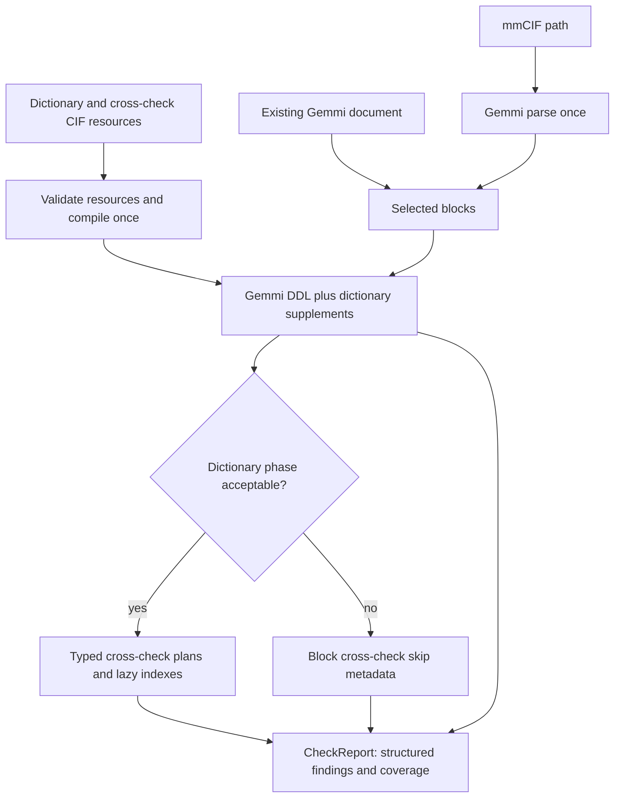

# mmCIF validation engine for `onedep_lib`: implementation specification

Status: implementation contract, based on source inspection and executable probes on 2026-10-12. The validation module and integration are implemented; this document remains their acceptance contract.

Target: `/home/wbueno/repos/onedep/onedep_lib`, package `src/onedep_lib`. Source paths below are relative to the separately audited `mmcif-validator` repository. Source validator revision: `9357faf06ac722eac15d5a827a4716763cfe1fd9`; target library revision: `3857cbc5c30257c47c8e3d0de3a89094566319cf`. The inspected rule file is `../vscode-extension/python-script/rules/data/cross_checks.cif`, SHA-256 `a377cc2fe60a6848fc3634e7fd4ba45d75fa766958ec115b4bd902bfdc9d1b7e`.

**Implement a deep `onedep_lib.validation` module with a small interface: prepare dictionary/rule resources once, validate a path or an existing Gemmi document, return the library's structured check report. Parse the input once with Gemmi. Run the complete dictionary phase before cross-checks. Compile CIF rules directly into immutable typed plans; use projected column access, reusable hash indexes, and bounded result collection.**

“MUST” denotes acceptance requirements; “SHOULD” permits a documented, tested alternative. Legacy observations are evidence, not instructions to reproduce bugs. Sections 7–10 define normative rule behavior. Section 13 enumerates intentional differences from the old validator.

## 1. Scope and deliverables

The implementing agent MUST deliver:

1. A synchronous typed Python module supporting Python 3.9 and later, matching `onedep_lib`'s Hatch build, Ruff, `ty`, pytest, and `py.typed` conventions.
2. Gemmi parsing shared by dictionary checks and cross-checks; reuse callers' parsed `gemmi.cif.Document` objects without serialization/reparsing.
3. Gemmi DDL validation, a diagnostic adapter, and narrowly scoped dictionary-driven supplements for documented coverage gaps.
4. All 149 root rules and all child/branch rows in the inspected CIF, with persistent source rule IDs and messages.
5. Dynamic loading from caller-specified local dictionary/rule paths and bundled cross-check resources. No dictionary download or network access inside validation.
6. Structured reports, JSON serialization, execution provenance, phase/rule coverage, predictable errors, logging and performance instrumentation.
7. An adapter for existing `checks.runner.CheckRunner` / deposition interfaces; regression, semantic, resource, and performance tests; installed-wheel resource tests; user and maintainer documentation.

Scientific geometry, structure-quality scoring, completeness percentages, deposition networking, JSON-schema checks for required files, editor character highlighting, and asynchronous batch orchestration are separate responsibilities. Do not import the old Python scripts into the library, copy their parser, or build a second full DDL validator. Do not require pandas, NumPy, a database, or a compiled custom extension for the first implementation.

The other legacy checks outside `cross_checks.cif` need explicit coverage accounting: dictionary foreign keys, PDBx deposition mandatory items, strict/advisory ranges belong to the dictionary phase; assembly `oper_expression` membership is an additional domain check and MUST be migrated to a CIF procedural rule if retained. It must not survive as an undocumented hardcoded check.

### 1.1 Accepted integration amendments

The following decisions were accepted during the implementation interview on 2026-10-12 and take precedence over conflicting integration guidance elsewhere in this document:

- Validation findings MUST NOT prevent deposition submission. Preserve finding severities, report validity and coverage; advisory submission policy does not redefine those results as successful validation. See [ADR 0001](../adr/0001-advisory-mmcif-validation.md).
- Required-file checks remain the responsibility of the existing JSON-schema check runners. mmCIF dictionary checks, cross-checks and category/field presence checks use one shared mmCIF adapter, with any retained CheckRunner mmCIF methods delegating to it. Deposition must not require custom required-file runners to implement new mmCIF context logic. See [ADR 0002](../adr/0002-separate-required-file-and-mmcif-checks.md).
- Dictionary resource paths MUST be supplied through `DepositConfig` and used to instantiate validators. The production interface MUST support keyword-only `mmcif_validator=`. With configured dictionary paths, `deposit_init()` and `deposit_resume()` prepare and reuse the required engines per distinct resource profile within the deposition object. Supplied prepared validation dependencies take precedence for their routes and permit reuse across deposition objects. See [ADR 0003](../adr/0003-config-backed-prepared-validator.md).
- Explicit mmCIF check calls return reports. `deposit()` MUST also invoke the same mmCIF validation implementation internally before submission, using current file contents rather than reusing a previous explicit-check result. Findings remain advisory. Keep the deposition-ID return value, expose reports through `metadata_report[file_id] -> CheckReport`, and log an issue summary. Preserve each file's independent resource provenance and coverage.
- A configured dictionary or rule resource that is missing, invalid or incompatible MUST produce an explicit validation-unavailable report in the deposition workflow without preventing submission. Direct engine preparation still raises typed configuration errors. Do not silently convert unavailable validation into complete or valid validation.
- Automatic validation MUST cover every registered mmCIF file. `DepositConfig.mmcif_rule_paths` selects cross-check resources by declared file-type value. `co-cif` defaults to the packaged bundle; other unmapped mmCIF types receive dictionary checks and explicit unavailable cross-check coverage. Never silently apply coordinate rules to another unmapped file type or describe that partial check as complete full validation.
- Gemmi MUST be a normal package dependency, rather than an optional validation extra. Its supported version range remains subject to the capability tests specified below.

## 2. Evidence and current execution

Entry point: `validate_mmcif.py`, `ValidatorFactory.validate()` (lines 82–102), reparses the dictionary and file for every call. `validator.py`, `MmCIFValidator.validate()` (22–33), runs duplicate detection, undefined/mandatory checks, item checks, registered cross-checks, parent/child checks, then assembly operation references. Thus relational dictionary checks currently occur **after** cross-checks.

`rules/engine.py` registers one rule group. `rules/cross_check_cif.py`, `load_rule_documents()` (127–138), parses the CIF through the custom parser and reconstructs twelve former JSON documents. `rules/imported_cross_checks.py`, `run()` (1839 onward), calls twelve family evaluators within a roughly 1,850-line class. Rules already come from CIF; the problem is the legacy representation and execution design, not absence of a data source.

`cif_parser.py`, `get_category_rows()` (389–415), scans all stored item names, reconstructs every row as a dictionary, and aligns independent value arrays by index. The caller repeatedly uses `cache.setdefault(category, mmcif.get_category_rows(category))`; Python evaluates the default argument even when the key is cached. The cache therefore retains rows while still paying to rebuild/discard them.

### 2.1 Audit findings and required response

| Finding / source evidence | Consequence | Required design response |
|---|---|---|
| Handwritten tokenizers in `cif_parser.py` and dictionary regex parsing in `dict_parser.py`; quoted frame values use `strip("'\" ")` | CIF token identity and whitespace can change; syntax and dictionary features are fragile | Gemmi is the sole semantic parser; distinguish raw tokens from decoded strings |
| Parser intentionally stops at the second `data_` block | Later data silently escape validation | Validate every selected block independently; explicit selection with reported scope |
| Row arrays reconstructed without physical table identity; partial rows can be stored | False joins, malformed input accepted far enough to produce misleading findings | Fail on Gemmi syntax errors; preserve block/table/row identity |
| Eager `setdefault` arguments throughout rule group | Repeated full category scans and row allocations | Lazy projected access and explicitly tested cache construction counts |
| `_linked_matching_targets()` scans all target rows per source row; wavelength code does the same | Quadratic CPU cost; additional repeated row rebuilding | Shared multimaps keyed by join columns; no guessing on mismatched keys |
| `_run_pairwise()` uses a Cartesian cross-category comparison | Potential quadratic work and ambiguous correspondence | Preserve the specified existential comparison; optimize using operator-specific extrema/set summaries |
| `_run_sequence_model_mismatch()` sliding windows compare each possible offset against every modeled residue | Quadratic fallback on long polymers | Indexed label mapping first; explicit bounded fallback, honest incomplete coverage when budget exceeded |
| Sequence grouping uses author chain and residue, omitting model and entity identity | Different models/chains can merge; wrong residues or anchors win | Block/model/label-chain/entity-aware residue identity |
| Occupancy grouping prioritizes author chain and author residue without label-chain disambiguation | Author identifiers can conflate distinct atoms | Separate canonical identity from author-facing display |
| `_validate_parent_child_relationships()` uses physical line numbers to associate entity types | Multiple rows on one line and rows split across lines break associations | Structural rows and ordered composite tuples, never physical lines as keys |
| `validator.py` has many specialized type patterns; two nested `_matches()` implementations duplicate accession logic | Drift, repeated work, hardcoded resource policy | One format compiler; patterns in CIF resources |
| Context resolver accepts experiment/subtype/code lists, but `MmCIFValidator` passes none | Most selector-gated cross-references and subtype rules silently inactive | Typed context; documented session/file resolution; per-rule skip reasons |
| Unsupported operators, malformed rules and invalid regex often `continue`; optional configuration errors are ignored | Incomplete validation looks successful | Validate/compile once; typed configuration errors, no silent rule loss |
| Rule adapter drops root IDs when rebuilding JSON dictionaries; `ValidationError` lacks phase/rule ID/block/row | Callers cannot distinguish or attribute failures reliably | Preserve source IDs and structured locations in every cross-check issue |
| `_render_message_template()` silently deletes unknown placeholders and collapses whitespace | Bad templates become plausible but incomplete messages | Compile template tokens; reject unknown names; preserve source message text |
| Loader cache is global, mutable, keyed by path/mtime only | Stale content, caller mutation, unbounded growth and uncertain concurrent behavior | Engine-owned immutable resource snapshot identified by content digest |
| Missingness varies across present checks, joins, empty string checks, and numbers | Empty strings and missing values can pass inconsistently | Shared explicit value states and family-specific policies |
| Number conversion is `float()` and date helper compares unchecked tuples | NaN/infinity can evade comparisons; impossible dates order as valid | Finite numeric conversion, strict date/time validity, dictionary findings for malformed data |
| `_validate_undefined_and_mandatory_items()` only reports undefined names without `_` | Standard-looking unknown tags effectively pass that check | Gemmi unknown-tag diagnostics with explicit severity policy |
| No dictionary-first gating | Cascaded misleading domain findings on malformed inputs | Dictionary phase barrier and explicit continuation policy |
| CLI/library factory mixes resource acquisition, parsing and computation | Expensive repeated startup, difficult dependency injection | Resource preparation separate from per-input evaluation |
| Logging exists in CLI/factory, but not useful rule-level timing/cache/skip metrics | Hard to explain slowness and missing checks | Module logger and structured optional profiling; no handler configuration |
| Tests call private family methods and filter message substrings; broader suite snapshots whole subprocess output and can download dictionaries | Weak public-interface coverage, external variability, no scaling guarantees | Offline public-interface tests, rule IDs and exact outcomes; benchmark fixtures and capability probes |

### 2.2 Verified baseline, not a promised speedup

Executed `python -m unittest discover -s testing -p 'test_*.py' -v`: **17 tests pass** (six linked fallback, six occupancy, five sequence tests). This does not establish complete dictionary or all-family coverage. The full network-capable snapshot suite was not run.

An isolated probe warmed rule loading, then called `_run_linked()` on generated matching `reflns`/`refine` loops, each with N rows, consistent values and zero issues. Medians of three runs on this workstation:

| N rows per category | Seconds |
|---:|---:|
| 100 | 0.0490 |
| 200 | 0.1099 |
| 400 | 0.4795 |
| 800 | 2.0003 |

The 400→800 ratio is about 4.17, consistent with quadratic work. This measures legacy linked evaluation, not parsing, DDL validation or end-to-end performance.

For `testing/cif_files/6qvt.cif`, legacy cross-checks alone (dictionary omitted, rules warm) under `cProfile`: 4,835 atom rows, 2 issues, 0.201 s, about 966,000 calls. Category reconstruction was called 157 times, including `refine` 74 times and `atom_site` twice, consuming about 0.098 s cumulative. Profiling overhead makes this unsuitable as an absolute performance target. Real-file memory and dictionary costs were not measured. Archive reproducible new benchmark commands/results before claiming improvements.

## 3. Gemmi integration and verified limitations

Read the accompanying [Gemmi research](gemmi-validation-research.md) before implementation. Primary references: [Gemmi CIF interface](https://gemmi.readthedocs.io/en/latest/cif.html), [DDL implementation](https://github.com/project-gemmi/gemmi/blob/v0.7.4/include/gemmi/ddl.hpp), [Python bindings](https://github.com/project-gemmi/gemmi/blob/v0.7.4/python/cif.cpp). The research records versioned probes rather than relying on latest documentation alone.

Use `gemmi.cif.read_file(str(path))` and caller-provided `gemmi.cif.Document`; use `find_values`, `find_mmcif_category`, table/column handles and `gemmi.cif.as_string` / `is_null` as verified for the chosen version. Category dictionaries that decode nulls eagerly are unsuitable for raw-token identity. Quoted `'?'` and `'.'` are strings; bare `?` and `.` are null markers. Check raw tokens before decoding.

Gemmi owns the parsed data in C++. Holding columns/tables is not equivalent to copying the entire category to Python, although each retrieved Python string may allocate. Keep strong document ownership for the duration of each run. Do not mutate caller-owned documents or create a `Structure` merely to access CIF data: that projection can lose metadata needed by these rules.

`gemmi.cif.Ddl` takes a logger callback and explicit options; `read_ddl(document)` loads a dictionary; `validate_cif(document)` returns a Boolean and emits diagnostic **strings**, not typed findings. `read_ddl` moves/consumes the dictionary document in the inspected binding. Extract required dictionary metadata first, then transfer ownership. Retain original dictionary bytes/digest for provenance, not a supposedly reusable emptied document.

The tested Gemmi 0.7.4 implementation and inspected 0.7.5 source have material gaps:

- Missing mandatory items, missing parents, duplicate keys and unknown tags can emit diagnostic messages without making the Boolean false.
- Invalid integer input can return true without a diagnostic; upgrading to 0.7.5 alone does not fix the inspected source path.
- Parent checks can miss violations when input tag spelling is uppercase, although CIF tag identity is case-insensitive; enabling parent checking alone does not certify its coverage.
- Value diagnostics may stop after the first invalid value in a column. DDL diagnostic count is not the count of invalid cells.
- PDBx deposition mandatory codes, PDBx advisory ranges and detail-based cross-enumerations need explicit capability verification and dictionary metadata handling.
- Python does not expose a complete structured diagnostic/location interface, or `validate_block` in the inspected bindings.
- No assumption of GIL release, safe concurrent reuse of mutable DDL state, or exact per-value source positions is justified.

Consequently, MUST derive dictionary phase success from **backend Boolean AND normalized diagnostic severity AND supplements**, not the Boolean alone. Test the chosen dependency version against integer, mandatory, unknown-tag, duplicate-key, missing-parent, composite-link, tag-case invariance, and range fixtures before declaring support. Use a tested `gemmi>=0.7.4,<0.8` compatibility range initially, tighten if probes fail, and record the actual version in each report. Install into the target library environment during implementation; it currently has no Gemmi dependency. Treat the range as a proposed range subject to CI against both ends, not as evidence every version works identically.

Configure the inspected binding explicitly as follows; the collector is bounded and separates preparation from validation diagnostics:

```python
ddl = gemmi.cif.Ddl(
    logger=(collector, 6),
    print_unknown_tags=True,
    use_regex=True,
    use_context=False,
    use_linked_groups=True,
    use_mandatory=True,
    use_unique_keys=True,
)
ddl.use_deposition_checks = False  # set before read_ddl()
```

The binding's `use_linked_groups` enables parent validation, including its linked-group mechanism. Keep this enabled by default to retain foreign-key coverage. Gemmi documents known PDBx parent/schema mismatches: certify the configured dictionary with the capability/real-file corpus; do not suppress all parents to hide false positives. A caller may explicitly disable parent checking, but the report must then label parent coverage disabled/partial, not certified full dictionary validation. `use_context=False` avoids treating internal `WWPDB_LOCAL`/deprecated-item context as an automatic domain violation; enable it only in an explicit policy. Standard DDL plus explicit PDBx supplements is the initial profile. Deposition overrides can be an opt-in tested profile with `use_deposition_checks=True` and corresponding effective metadata selection. Threshold 6 is required to capture resource/type-definition problems otherwise dropped by lower logger thresholds. Do not inherit version-dependent defaults. The accompanying research's sample standard/unknown-tag policies are alternatives; this specification's explicit settings and WARNING unknown-tag default are normative.

## 4. Module structure and interfaces

### 4.1 External interface

Export only `MmCifValidator`, `ValidationOptions`, `ValidationContext`, `PreparedRules`, `ValidationConfigurationError`, and existing report types as needed. Callers normally need one preparation call and one validation call. `PreparedRules` is returned by compilation for inspection/reuse; callers cannot construct unchecked plans.

Illustrative Python-3.9-compatible interface (implement concrete annotations, docstrings and defaults):

```python
from pathlib import Path
from typing import Optional, Sequence
import gemmi
from onedep_lib.checks.report import CheckReport

class MmCifValidator:
    @classmethod
    def load(
        cls,
        dictionary_paths: Sequence[Path],
        *,
        rules_path: Optional[Path] = None,
        options: Optional["ValidationOptions"] = None,
    ) -> "MmCifValidator": ...

    def validate_path(
        self, path: Path, *, source: Optional[str] = None,
        context: Optional["ValidationContext"] = None,
    ) -> CheckReport: ...

    def validate_document(
        self, document: gemmi.cif.Document, *, source: str,
        context: Optional["ValidationContext"] = None,
    ) -> CheckReport: ...

    @property
    def rules(self) -> "PreparedRules": ...
```

`load` resolves and reads resources once, computes digests, validates the entire bundle, extracts dictionary metadata and compiles plans. An explicit empty dictionary list is allowed **only** with `phases=("cross",)`; full/default validation without dictionaries raises `ValidationConfigurationError`. Omitted rules path selects the packaged rules bundle. Dictionary-only mode need not load cross-check resources. Do not use a fake empty dictionary to make full validation look successful.

`validate_path` reads/parses once and returns a report; ordinary file-not-found, permission, corrupt compression and CIF parse errors produce FATAL input findings. `validate_document` uses exactly the supplied document, with source provided by its owner; input digest can be null because original bytes are unavailable. Both validate selected blocks independently, never join across blocks, and release all per-run caches on return. Neither accesses the network or prints.

Resource/configuration errors are raised at preparation, since there is no input report to attach them to. Unexpected implementation errors MUST propagate with their traceback; the deposition adapter may translate them to a fatal `VALIDATION_INTERNAL_ERROR` when its public contract requires a report, while logging the exception. Do not blanket-catch exceptions in family evaluators.

### 4.2 Options and invariants

Make options immutable. Invalid combinations fail during preparation.

| Option | Default / contract |
|---|---|
| `phases` | `("dictionary", "cross")`; dictionary-only and cross-only explicit, output labels requested scope |
| `dictionary_failure_policy` | `"stop_block"`; `"continue_safe"` is reserved and unavailable in this release |
| `blocks` | All blocks; optionally explicit ordered block-name selection. Unknown/ambiguous selection is a configuration/input finding, never silently first block |
| `max_issues` | 10,000 retained substantive findings; `None` means unbounded by explicit caller choice |
| `max_value_chars` | 1,024 characters per copied context value; exact message substitutions use rule-specific compact display, with truncation marked |
| `max_diagnostic_chars` | 4,096 retained characters per backend diagnostic; retain original length/digest and explicit truncation metadata |
| `max_related_locations` | 32 per issue; count and truncation marker always available |
| `max_alignment_cells` | 1,000,000 legacy fallback comparisons per block; exhaustion produces an incomplete-rule finding |
| `unknown_tag_severity` | WARNING; report unknown tags, configurable to ERROR |
| `dictionary_context_checks` | False; explicit internal/deposition policy switch, passed to `use_context` |
| `dictionary_parent_checks` | True; disabling declares partial dictionary coverage |
| `dictionary_deposition_overrides` | False; enabling switches effective dictionary types/enums/ranges to tested PDBx overrides |
| `rule_dictionary_policy` | `"error"` by default; `"block_rule"` explicitly reports incompatible rules as unavailable while compatible rules may run |
| `profile` | False; phase times and counters still available, per-rule timings optional |
| `cancelled` | Optional zero-argument callable; checked at phase/rule transitions and bounded batches (e.g. every 4,096 rows) |

The engine has an immutable prepared rule snapshot but mutable Gemmi DDL/logger state. Serialize concurrent validations using the same engine with a per-engine lock covering the run (simplest correct first implementation). Provide separate engines per worker for parallel throughput. Do not hold a module-global lock or global document cache. Do not promise parallel speedup from Python threads or expose undocumented async execution. A caller must not mutate a document while its validation is running.

`ValidationContext` has `experiment_modes: Optional[tuple[str, ...]]=None`, `entry_subtypes: Optional[tuple[str, ...]]=None`, `requested_codes: Optional[tuple[str, ...]]=None`, and `block_overrides: Mapping[str, ValidationContext]` defaulting to an immutable empty mapping. Override contexts cannot contain further overrides. Block names must identify a unique selected block; ambiguous duplicate block names are an input error. Validation options belong to the prepared engine, not the context. Reject option values such as a negative cap, unknown phase, duplicate phase, or `("cross", "dictionary")` rather than reordering silently. Dictionary failure-policy and profile switches are resource-fingerprint inputs.

`PreparedRules` exposes immutable `bundle_id`, `schema_version`, `version`, `digest`, `root_rule_count`, and `rules` (ordered immutable descriptors containing `id`, `family`, `source_category`, `source_row`, projected tags and selector dependencies). Internal executable plan fields stay private. This permits inventory/debug inspection without making evaluators or cache objects part of the external interface.

### 4.3 Internal seams and layout

```text
src/onedep_lib/validation/
    __init__.py             # small public exports
    engine.py               # preparation, phases, block iteration, gating
    models.py               # options/context/plans/execution metadata
    cif_access.py           # block-local projected tables, columns, row references
    dictionary.py           # Ddl ownership + normalized diagnostics + supplements
    rule_loader.py          # CIF schema validation, typed plans, digests
    values.py               # null/empty/number/date conversion
    messages.py             # compiled templates and bounded context
    indexes.py              # block-local lazy multimap/set/summary construction
    evaluators/
        comparison.py       # numeric/date rules
        relational.py       # uniqueness/linked/cross-reference
        conditional.py      # required/regex/enumeration/category triggers
        presence.py         # mandatory and one-of
        dictionary_enum.py  # rule-selected cross-enumeration metadata
        accession.py        # generic conditional formats/values
        wavelength.py
        occupancy.py
        sequence.py
    data/
        cross_checks.cif    # versioned rule source, messages, format definitions
```

Files may be combined if they remain cohesive; do not create one wrapper per trivial helper. The dictionary adapter hides Gemmi-specific logger behavior. The evaluator seam is private and concrete: a mapping from a supported family/kind to a compiler/evaluator callable, not arbitrary dynamic imports, `eval`, executable rules, or a public plugin framework. `cif_access` is a concrete Gemmi implementation; do not invent multiple backends without a real need. Report construction reuses the existing `checks.report` model.

An evaluator accepts an immutable plan, a block-local run context and an issue collector; it MUST neither read files, mutate data, parse rules, create a logger, nor own its own cache. Tests exercise the external engine interface; smaller compiler/conversion tests are appropriate for malformed-resource cases and semantic edge cases.



## 5. Shared data access and resource lifetime

### 5.1 Table identity

Represent a location with block index/name, table index, category, zero-based row and canonical full tag. Tags/categories are case-insensitive identifiers; use lowercase lookup keys while retaining original source spelling and rule ID. Values are case-sensitive except where a family explicitly defines normalization. Display `_refine.ls_R_factor_R_work` from rule metadata even if lookup uses lowercase.

A physical loop or collection of category scalar pairs is a table. Category scalar pairs form one row independent of line adjacency. Tables with unrelated categories/ambiguous splits MUST NOT be zip-merged by matching array lengths. If a category has disjoint tables that cannot be represented as one well-defined logical relation, emit a structural dictionary ERROR and gate that block; no guessed row correspondence. Distinct loops containing the same tags are duplicates (normally rejected by Gemmi). A loop containing multiple mmCIF categories is an unsupported/invalid mmCIF table layout for this engine: report a dictionary ERROR with the table, rather than synthesizing categories. Save frames in an input data file must be explicitly rejected as unsupported input scope; dictionary save frames are handled normally at preparation.

Discover table/tag handles once per block. Project only columns required by enabled plans; build synthetic row cursors from integer indices, never a `dict[str, ItemValue]` per cell/row. Mandatory-if-any rules may require **all** columns in their category to compute a signal; that is a deliberate projection exception. Internal handles expose `row_count`, `raw(tag,row)`, column existence, and location derivation. Access of an absent column yields the ABSENT sentinel, not an exception or a manufactured null token.

### 5.2 Shared indexes

The run context owns lazy cached indexes keyed by `(block, table/category, ordered tags, normalization_policy, missing_policy)`. Include the normalization/missing policy in keys to prevent accidentally reusing casefolded accession indexes for exact IDs.

- Join multimap: normalized key tuple → ordered target row indices; preserve duplicate-key rows for existential comparison and diagnostics.
- Membership set: present normalized values/tuples → existence; keep one witness row when reporting related context.
- Numeric summary: finite min/max and deterministic witness, plus value membership/witnesses for equality predicates.
- Dictionary cross-enumeration map: prepared resource metadata, reused across files.
- Polymer sequence map and compact residue/atom grouping: built only when relevant rules run.

Use explicit lazy construction (`if key not in cache: cache[key] = build(...)`), never eager `setdefault(build(...))`. A resource-missing column may cache an empty handle/index. Build once per signature; record construction counts. Prefer direct projected iteration to decoded-column caches; cache typed conversion only when repeated use justifies it, keyed by column and conversion policy. Budget memory proportional to projected rows and distinct keys, not all CIF cells times all rules. Release per-block caches before moving to the next block when no later phase needs them.

### 5.3 Resource snapshots

Prepared plans and metadata are deeply immutable (tuples/frozen dataclasses/readonly mappings); do not return mutable nested dictionaries from `rules`. Store source path/resource ID, schema version, bundle digest, dictionary digests, backend version and prepared counts. Digest content, not mtime alone. Explicit new `load` creates a new snapshot after resource updates; existing engines remain reproducible. This satisfies dynamic rule updates without per-rule file stats or background watching. Avoid a global cache in v1; if later added, it must be bounded, keyed by content/version/options and hold no input documents.

Use `importlib.resources` for packaged CIF data and include it in Hatch wheels/sdists. Materialize temporary resource paths only for APIs that require paths, with explicit lifetime. Supply dictionaries externally; bundling the large PDBx dictionary is not necessary. Dictionaries loaded together need deterministic precedence: reject conflicting duplicate item definitions unless an explicitly supported overlay policy is added and tested. Never silently depend on file order to select inconsistent definitions.

## 6. Phase execution, diagnostics and results

### 6.1 Dictionary barrier

For a multi-block document, run dictionary validation and supplements for **all selected blocks** before any cross-check evaluation. Python DDL validates documents: reuse the original when every block is selected; for subsets make an in-memory document/block copy, never stringify/reparse. Map copy block identities back to originals. If diagnostic grammar cannot attribute an error to a block reliably, conservatively gate all selected blocks and record the ambiguity. Dictionary setup diagnostics from resource preparation must not be mistaken for findings in the user file.

Default `stop_block`: cross-checks run on blocks with no dictionary ERROR/FATAL and backend acceptance. Dictionary warnings alone do not gate unless promoted. A block with an opaque failure is blocked. Rule metadata records `blocked_dictionary`, with no fabricated per-row violations.

Opt-in `continue_safe`: run only plans whose inputs can be proven safe using supplements/structured diagnostics. Unknown diagnostic scope blocks the entire block; missing prerequisites, malformed numeric values, invalid keys and ambiguous table layouts block dependent plans. Do not infer an invalid-cell map from Gemmi's first-error-per-column diagnostics. Invalid-column granularity is the minimum reliable gate when a column is identified. Always mark partial coverage. Do not make this mode a prerequisite for initial release; default gating is required.

Backend Boolean false with no recognized diagnostic creates an ERROR `DICTIONARY_VALIDATION_FAILED`. Normalize known message shapes using a **versioned** adapter and fixture corpus. Preserve every original diagnostic verbatim in bounded backend context. For mandatory/key/parent messages promote to ERROR even if the backend calls them warnings; advisory ranges remain WARNING; unknown tags use the configured policy. Unknown nonempty diagnostic messages conservatively become ERROR `DICTIONARY_DIAGNOSTIC_UNCLASSIFIED` and block, never vanish. Ignore only explicitly tested informational/debug forms. Set the Gemmi logger threshold so findings are collected; collect dict-loading messages separately.

Report `diagnostics_exhaustive=false` for Gemmi value diagnostics unless the selected backend/supplements demonstrably enumerate all failures. Structured locations may be partial. Do not invent source dictionary rule IDs for opaque messages: use stable check codes and `rule_id=null`, with dictionary digests and a definition tag/frame when known.

### 6.2 Dictionary supplements: limited and data-driven

Extract metadata using Gemmi while the dictionary document still exists: item aliases/name/category, types and primitives, category keys, item and PDBx mandatory codes, enumeration rows/details, strict/advisory ranges and link groups. Retain only metadata required by gaps/cross rules. Accept historical alias declarations while validating canonical mmCIF tags. Actual use of an unsupported alias must emit an attributed finding and mark the affected block incomplete. Shared frames can declare child-item references alongside a primary definition; such references must not be mistaken for conflicting second definitions. Inherit missing type metadata while rejecting genuinely conflicting types or primary definitions.

Required for the tested backend:

1. Integer validation: the demonstrated bug is specifically effective item type code `int`. Read `_item_type.code` from each definition; when the deposition-override profile is enabled, use a present `_pdbx_item_type.code` instead. Resolve every `_item.name` row in a definition, not only its save-frame title. Validate non-null raw tokens with `re.fullmatch(r'[+-]?[0-9]+', raw)` to mirror Gemmi's integer lexical intent; do not strip/unquote or use Python `int()` as the lexical test. Reject fractions, exponents, quoted integers, Unicode digits, NaN/infinity, sign-only tokens and trailing garbage. Do not classify every `primitive_code=numb` as integer or infer integer semantics from tag/type name substrings. Other type codes are validated through their dictionary `_item_type_list.construct` regex by Gemmi; supplement a different code only if capability tests demonstrate a separate gap. Add regression for the silent-invalid-int Gemmi path.
2. `_pdbx_item.mandatory_code=yes`: when the category exists, require the tag and a filled value in each row. Standard `_item.mandatory_code` handling follows DDL, without assuming every absent category is mandatory. A present empty quoted value is unfilled for deposition mandatory checks.
3. `_pdbx_item_range`: advisory warnings from dictionary ranges, with union-of-ranges behavior. `_item_range` is strict: default DDL bounds exclusive, except identical min/max denotes that exact permitted value; verify actual backend semantics with tests. Supplement only gaps the capability suite proves, and avoid duplicate DDL findings for the same defined failure.
4. Nonfinite numeric rejection for dictionary numeric primitives, independently of Gemmi regex acceptance.
5. Tag-case invariant parent/link validation: the affected Gemmi versions require a dictionary-driven supplement or a patched backend. Compile `_item_linked` and `_pdbx_item_linked_group_list` declarations into canonical tag plans before dictionary ownership transfer. Simple links use a target membership set; composite links use ordered child/parent tag tuples with the declared link-group identity. Missing child keys skip relationship comparison (mandatory checks remain independent); populated child tuples require a populated corresponding parent tuple. An absent parent category is an empty set, not a success. Distinct alternative link groups must retain the dictionary's declared semantics and be certified against fixtures, not combined into a tuple using arbitrary set order. The supplement reads canonical tag handles and shares block indexes; do not lowercase/mutate or copy the entire input merely to work around the backend bug. Skip/deduplicate only backend findings proven to describe the same failure; opaque backend warnings remain reportable. Parent false positives and polymorphic atom links require dictionary-profile fixtures rather than item-name exceptions hidden in code.
6. Calendar validity for the supported date profile: apply the strict conversion in section 8.1 to the date operands referenced by date-order rules, report `DICTIONARY_TYPE` for a PRESENT impossible calendar/time value before cross execution, and use its dictionary definition tag when available. If the dictionary does not define a referenced date tag, fail the configured dictionary/rule compatibility check rather than label a rule-derived parser assumption as an arbitrary DDL rule. Other dictionary date types require an explicit tested profile before semantic calendar validation is claimed.

Use Gemmi for DDL types, ordinary enum membership, keys/context and linked groups. Foreign-key tuple support and regex behavior must pass fixtures for the supplied dictionary profile; if a required capability is absent, fail preparation or implement one clearly named dictionary-driven supplement. Never silently advertise complete DDL2/PDBx coverage. DDL1/DDLm/custom dictionaries are outside this first module's certified PDBx/DDL2 profile; explicitly reject unsupported profiles unless separately tested.

### 6.3 Reuse `checks.report`

The target already defines `CheckSeverity`, `CifLocation`, `CheckIssue`, and `CheckReport` in `src/onedep_lib/checks/report.py`. Preserve their existing positional fields and behavior for non-mmCIF checks. Add optional/defaulted fields **after existing fields**, so existing callers remain compatible:

```text
CifLocation:
    existing data_block, category, item, row, line, column
    + block_index, table_index, loop_column

CheckIssue:
    existing severity, code, message, location, expected, actual
    + check_type: Optional[str]         # input, dictionary, cross, engine
    + rule_id: Optional[str]
    + related_locations: tuple[CifLocation, ...]
    + context: JSON-compatible mapping

CheckReport:
    existing source, issues
    + validation: Optional[ValidationMetadata]
    + to_dict() and to_json() with explicit stable serialization
```

Keep frozen issue/location models; freeze nested validation context or defensively copy it. `expected`, `actual`, and context generated by this engine must be JSON-safe: no Gemmi handles, enums, sets, paths, datetime objects, exceptions, NaN or infinity. Existing non-validation reports can use their old fields; serializer must define handling for unsupported caller-provided `Any` values (raise a clear serialization error, never `repr()` arbitrary objects).

Locations: `row`, `block_index`, `table_index`, `loop_column` are zero-based; `line` is one-based; existing `column` denotes character offset, zero-based, **never a loop column**. Exact source line/column can be null. Gemmi item/loop line anchors may be available; identify anchor accuracy in context (`location_precision=cell|item|table|block|unknown`). Missing item findings locate the category/table/trigger row and preserve the missing full item tag. Caller-provided documents generally lack exact cell positions.

`ValidationMetadata` fields:

- `schema_version="1.0"`, engine/backend versions, dictionary IDs/digests, rule bundle ID/version/digest, optional input digest, options, requested dictionary capability scope and resolved selector context.
- Requested phases and selected/excluded blocks; `complete` means every requested applicable check finished, even if violations were found. `valid` is true only if `complete` and no ERROR/FATAL. A blocked cross phase makes full validation incomplete. Cross-only validity is explicitly validity for the requested scope.
- Phase records: `status=completed|skipped|blocked|failed|cancelled|truncated`, duration, backend Boolean when relevant, counts and diagnostic-exhaustiveness flag.
- Rule execution records: source ID/family, `status=evaluated|not_applicable|blocked|unsupported|cancelled|truncated`, aggregate rows examined, findings emitted, skip-reason counts, optional elapsed time. Status `evaluated` does not imply every possible row compared; counters must describe invalid/missing/conditional skips.
- Retained error/warning counts, `truncated`, issues observed before stopping, and omitted count only when known. Never claim a total number of unseen findings after an early stop.

Keep `CheckReport.ok` compatible, based on absence of ERROR/FATAL. The validator ensures unfinished execution due to cancellation, capacity, unsupported required capability or internal adapter failure produces an engine FATAL issue, so `.ok` cannot misleadingly return true. Dictionary-gated incomplete full reports already contain an ERROR and need no additional noisy fatal. Benign `not_applicable` rules and explicitly unrequested phases do not make a report incomplete. Caller must inspect `validation.complete` to distinguish invalid-but-fully-evaluated from partial validation.

Use `code="CROSS_CHECK_VIOLATION"` plus the preserved `rule_id` and context family/branch for all domain violations. Dictionary/input/engine codes are stable named constants (`CIF_PARSE_ERROR`, `INPUT_IO_ERROR`, `DICTIONARY_TYPE`, `DICTIONARY_MANDATORY`, `DICTIONARY_FOREIGN_KEY`, `VALIDATION_CANCELLED`, `VALIDATION_LIMIT_REACHED`, etc.). Codes are for machines; messages come from the rule resources when present.

Example finding (illustrative values):

```json
{
  "severity": "error",
  "code": "CROSS_CHECK_VIOLATION",
  "check_type": "cross",
  "rule_id": "linked_reflns_number_obs_1",
  "message": "Observed reflections is lower than total reflections used in refinement 120",
  "location": {"data_block": "entry", "block_index": 0,
               "category": "reflns", "item": "_reflns.number_obs",
               "row": 0, "line": null, "column": null,
               "table_index": 3, "loop_column": 1},
  "expected": {"relation": ">=", "target_value": 120.0},
  "actual": "100",
  "related_locations": [{"data_block": "entry", "category": "refine",
                         "item": "_refine.ls_number_reflns_obs", "row": 0}],
  "context": {"family": "linked", "join_key": ["1"],
              "operator_role": "violation", "operator": "<",
              "fallback_used": false, "location_precision": "table"}
}
```

Replacement of `[{item2CrossValue}]` removes the whole placeholder token, producing `120` without surrounding brackets. Implement this exact rendering in message tests.

### 6.4 Ordering, limits and logging

Return findings in deterministic phase order (input, dictionary, cross, engine terminal), then block order, source family/root-rule order, row order and branch order. Preserve the linked break-group semantics before sorting. Do not sort by text/severity in a way that changes execution order. Ties/witnesses use the lowest original row index.

Deduplicate only identical failures within the same rule/check definition and location. Distinct source rule IDs remain distinct even if logically mirrored. For dictionary backend/supplement overlap, deduplicate only when definition/tag/location/category information proves the same violation; never merge opaque diagnostics by guessed substring.

On the first issue beyond `max_issues`, stop Python evaluation, mark truncated/incomplete, and append one terminal FATAL `VALIDATION_LIMIT_REACHED` **outside** the retained-issue cap. Thus at most cap+1 issues are retained. Do not keep generating millions of findings to count them. Gemmi's synchronous DDL call has no supported early-stop/cancellation interface: let an already-running native call return while its callback classifies events, updates independent failure/count state and discards excess stored diagnostics. Do not throw from callbacks to simulate cancellation or reset failure state after truncation. Subsequent supplements/cross-checks stop. Related-location caps are independent and explicit. Python loops must support collector-driven early termination; cancellation during native parsing/DDL is observed when that call returns. Document that latency, and leave hard process deadlines to a separate worker supervisor. For a call without requested phases, reject configuration rather than return a vacuous success.

Use `logging.getLogger(__name__)`, no `basicConfig`, print or handler setup. DEBUG: resource preparation/digests/counts and optional family timing/cache summaries. INFO: optional validation summary using source identifier and counts. WARNING/ERROR: execution/resource problems, not every normal domain finding. Do not log raw biological records or entire text values by default. Report deterministic counters; timing fields are optional/non-deterministic and excluded from exact snapshot comparisons.

## 7. Rule resource compiler

### 7.1 Schema and IDs

The existing rules document has one block `data_validator_rules`, **26 categories**, **149 root rules**, and child rows. Appendix A provides its exact column schema and counts. The compiler MUST load all root categories and validate every child row. Allow absent unused family categories in new custom bundles; the inspected v1 bundle must compile fully. Require each present category's mandatory columns, reject unknown non-extension columns, and verify all expected root IDs via an inventory test. Empty supported families are valid in new bundles; rules missing mandatory operands are errors.

Root IDs are opaque source IDs, including unusually truncated-looking cross-reference IDs; do not regenerate IDs from names. IDs must be globally unique within a bundle (the current bundle satisfies this). Parent/child references must resolve to the proper family and branch. Integers/ordinals must be positive, unique and contiguous within their logical group; order child rows by ordinal, root rows by physical resource order. Branches with multiple values must repeat identical driver/message metadata. Scalar conditions have exactly one value; list conditions can have several. `owner` must be `conditional_required` or `procedural`; required conditions belong to branch 1 in v1.

The `.` marker in **rule configuration** denotes absent optional configuration, interpreted by field schema. Literal quoted `'.'` remains a literal value. Required fields cannot be bare `.`/`?`. Boolean fields accept exactly `yes`/`no`; omitted optional flags have the documented defaults. Severity accepts `hard|error`→ERROR and `soft|warning`→WARNING; unknown severity fails compilation. Validate `scope`, `subtype`, selector tokens, operators, fallback policies, procedural kinds, format names, roles and placeholders. `pairwise.extra` is currently absent everywhere; reject any non-null value until an extension defines it. When dictionaries are configured, verify every rule-referenced definition exists in the selected dictionary profile. The default `rule_dictionary_policy="error"` fails preparation on incompatibility. The explicit `"block_rule"` policy retains missing definitions per rule, emits `CROSS_DICTIONARY_INCOMPATIBLE`, blocks those rules, and marks coverage incomplete while allowing compatible rules. The CLI selects this advisory resource policy. Cross-only mode without dictionaries can compile structural rules, but applicable dictionary-dependent rules still report blocked coverage.

Compile tags, conditions, regex patterns, format predicates, severity, message substitutions, child ordering, required-column projections and selector dependencies once. Plans are family-specific frozen types, not stringly typed heterogeneous list positions. Include `operator_role="violation"` for numeric/link comparisons and `operator_role="required_relation"` for dates to prevent inversion bugs. Registry lookup of an unknown kind is a preparation error with source block/category/rule/row information.

### 7.2 Complete messages and format definitions in CIF

The user's source-of-truth requirement exposes two real gaps in the current CIF: make-mandatory, one-of, cross-reference and dictionary-enum root tables lack messages; procedural formats reference names but the regex implementations are hardcoded in Python. MUST address these in the target's bundled resource, without changing the original rule file during this design task.

Implement additive schema v2, retaining all v1 IDs/categories/columns and semantics:

```text
_validator_rule_bundle.schema_version      2
_validator_rule_bundle.id                  onedep_cross_checks
_validator_rule_bundle.version             <release identifier>

loop_ _validator_rule_message.rule_id
      _validator_rule_message.role         # default, unmapped, mismatch
      _validator_rule_message.severity
      _validator_rule_message.template

loop_ _validator_rule_format.id
      _validator_rule_format.pattern
      _validator_rule_format.normalization # none, lower, upper
      _validator_rule_format.match_mode    # match (v1-compatible), fullmatch
```

Message rows are required for roots lacking inline messages; inline messages remain authoritative elsewhere and conflicting overrides are rejected. Cross-reference: `Cross-reference value '[{source_value}]' does not exist in '[{target_item}]'.`; mandatory: `No value present for this mandatory item.`; one-of: `At least one related item must be provided.`. Dictionary enum requires `unmapped` and `mismatch` rows carrying the existing wording in section 8.10. Format definitions contain the exact patterns and normalization in section 9.2. Updating those patterns/messages then requires only a resource update.

Accept the original schema v1 at a custom `rules_path`: use a **bundled CIF v1 compatibility defaults table**, keyed by family/message role and format ID, for its missing metadata. Record both digests and `legacy_defaults_used=true`. This is a limited bridge, not a JSON rules conversion. V2 bundles must be self-contained; unknown formats never fall back to Python code. The implementing agent must ship v2 and tests proving v1 compiles/evaluates the original bundle. New categories/formats that express supported primitives require no evaluator changes; fundamentally new algorithm kinds require a new tested evaluator (data updates cannot create arbitrary semantics).

### 7.3 Template syntax

Use literal `[{name}]` tokens. Replacement replaces the **whole token**, including its brackets/braces; do not use Python `str.format` on CIF messages. Allowed tokens are plan-specific: pairwise/linked `item2CrossValue`; dates `left_value,right_value`; uniqueness `duplicate_display,key_columns,category`; occupancy `chain,residue,comp,atom,model,total,occupancy`; sequence `chain,comp,residue,sequence_comp`; resource-added cross-reference/dictionary-enum `source_value,target_item,cross_item,cross_value,allowed_values`. Validate at preparation that each token is supplied by that evaluator/role. No unknown-token deletion, whitespace collapsing, translation or rewriting of supplied message content. Preserve decoded semicolon-field text, with only delimiter newline handling performed by Gemmi. Values such as numeric zero must not become empty because of truthiness checks.

## 8. Normative declarative rule semantics

### 8.1 Shared value policies

Classify raw cells as ABSENT, UNKNOWN (bare `?`), NOT_APPLICABLE (bare `.`), EMPTY (decoded empty/whitespace-only quoted/text value), or PRESENT. Keep these distinct in context. Null checks use raw token identity, not decoded string equality. Values `'?'` and `'.'` are PRESENT strings.

In explicit cross-only mode, a malformed PRESENT operand is a blocked rule input, not a benign missing-value skip: emit an engine ERROR `CROSS_INPUT_UNUSABLE`, mark the affected rule/coverage incomplete and do not invent a scientific comparison finding. The same applies to unprovable identity prerequisites. Missing/null optional comparison operands remain benign skips. This makes cross-only scope useful for small fixtures while preventing invalid conversions from appearing fully validated.

Required/has-signal/key checks treat ABSENT, UNKNOWN, NOT_APPLICABLE and EMPTY as unfilled. Comparisons skip unfilled operands; malformed PRESENT numeric/date operands belong to dictionary checks and block dependent comparison in safe-continuation mode. Conditions require PRESENT and compare decoded strings under the family's declared policy. Never trim ordinary identifiers or free text globally; trim only policy-defined inputs (join keys, accession formats, numeric/date parsing). Uniqueness/join keys use trimmed exact case-sensitive strings, to preserve legacy key intent; the raw original stays in context.

This intentionally corrects legacy empty-string and quoted-null behavior. Numeric parsing accepts dictionary-valid finite decimal/scientific numbers and, if permitted by the supplied dictionary type, CIF standard uncertainty notation `1.23(4)` (compare central value; preserve uncertainty/raw text in context). Do not strip uncertainty syntax from arbitrary strings. Validate dates as real calendar datetimes `YYYY-M-D` or `YYYY-M-D:H:M` per the legacy supported profile; date-only means midnight. No timezone conversion or newly accepted ISO formats without a rule/profile update.

### 8.2 Pairwise numeric (`validator_rule_pairwise`)

Fields describe source and target columns, message, violation operator and severity. Same-category operands are row-aligned within the same table. Cross-category rules retain legacy **any target value violates** semantics; they are not implicitly joined by IDs. Skip missing categories/operands. Emit at most one issue per source row per rule, with the first **violating** target witness (legacy sometimes uses an unrelated first target in the message; correct this).

For cross-category `left < any right`, summarize maximum right; for `left > any right`, summarize minimum; analogous inclusive operators use those extrema. `==` asks whether a target equals left (membership); `!=` asks whether any target differs (track distinct count/witness). Maintain deterministic lowest violating target row: an extremum witness alone may not be the first violating row. Implement an optional lazy range-extrema tree over target row order, storing min/max per subtree. After constant-time summary truth evaluation, find the first violating target by searching left subtrees first and pruning subtrees whose extrema cannot violate; build O(T), query O(log T). Equality uses a value→first-row map; inequality uses the first filled row and first row with a different value. This avoids scanning every target for every emitted finding. Cache trees by column/absolute-value policy and reuse them for linked duplicate-key groups where needed. Expected complexity O(S+T) for truth evaluation and O(T + V log T) witness work, where V is bounded retained violations.

### 8.3 Date order (`validator_rule_date_order`)

Same-row left/right date operands. `op` defines the required relationship, so `<=` violates only when left>right; equality is valid. Support the four ordering operators `<,<=,>,>=`; unknown tokens fail compilation. Missing dates skip; impossible dates never participate. Emit at the left cell and relate the right cell, substituting exact decoded date strings. O(rows).

### 8.4 Uniqueness (`validator_rule_uniqueness`, `_key`)

Build ordered composite keys from child items. Skip rows with unfilled key parts. A duplicate group emits an issue on **every participating row including the first**, anchored at the first key column, using comma-joined key parts for `duplicate_display` and item names for `key_columns`. Preserve duplicate-group membership/count in capped related context. Use O(rows) hash grouping storing row indices, not row dictionaries. Do not omit duplicate groups because the dictionary backend already checked keys: separate rule provenance is meaningful.

### 8.5 Linked presence/numeric (`validator_rule_linked`)

Join source `cross` to target `cross2`; absent `cross2` means use `cross` in the target category. Trim keys and exclude unfilled keys. Resolve all matching target rows via a multimap. Same-category linked rules join by key (not automatically current row), preserving behavior on duplicate keys when the dictionary allows evaluation.

- `operator=exists`: if any matching target row has a filled target item, the source item must be filled. Direction is **target presence requires source presence**.
- Numeric operators are violation predicates. Apply absolute values to both operands only when `absolute=yes`. Any violating numeric target emits one source finding; missing/nonnumeric targets cannot be witnesses.
- `warning=yes` means WARNING; default ERROR. Missing `absolute`, `warning`, `break_flag` mean false.
- `break_flag=yes`: after a violation, stop subsequent linked rules in the **same source-category/source-item group for that source row**, in original resource order. Do not stop other source rows, source items or families.
- No target match means no linked comparison finding; required parent/foreign-key failures belong to dictionary checks. Emit with source item tag even if absent, locating source key/table row.

Only `fallback=single_row_if_key_missing` permits fallback. After an unsuccessful key join: target category must have exactly one row and its target key must be unfilled; if the source key is unfilled the source category must also have exactly one row. A populated source key may use that missing-key singleton target even if there are multiple source rows. If both keys are populated and disagree, never fallback. Multiple targets never fallback. Report `fallback_used=true` and both raw key states. Retain all six existing fallback regression cases and add missing-source/multiple-source variants.

### 8.6 Conditional required (`validator_rule_conditional_required`, `_item`, `_condition`, `_skip_category`)

Category absent → not applicable. Skip the rule if any listed skip category has a table/row in the same block, regardless of its value fill state (e.g. `condreq_refine_1` is superseded by `pdbx_initial_refinement_model`). Within each row, every condition item must be PRESENT and match one allowed string; AND across items, OR across values for an item. V1 condition comparisons are exact case-sensitive decoded strings. When triggered, emit one finding per unfilled required item. `error=yes`→ERROR, `no`→WARNING; use `error_text` or `warning_text` selected by severity, reject a missing applicable message rather than invent text. Child order is normative. O(rows × small compiled condition/item counts).

### 8.7 Conditional regex (`validator_rule_conditional_regex`)

Same-row exact driver match. An unfilled target is handled by required rules and skipped here. For PRESENT target, evaluate compiled `re.match` semantics (the current pattern is anchored). Failure uses rule `error_text`, severity from `error`. Regex compilation errors are resource errors. New `fullmatch` behavior must be explicit, not silently applied to v1.

### 8.8 Conditional enum (`validator_rule_conditional_enum`, `_value`)

Same-row driver and affected item must be filled. Branch with exact driver match selects the permitted affected values, exact case-sensitive equality. Affected mismatch emits one ERROR at the affected cell with that branch's message and ordinal; missing affected value is left to required checks. If no driver branch matches, no finding. Duplicate/conflicting branch drivers are compiler errors.

### 8.9 Conditional category item (`validator_rule_conditional_category_item`)

Trigger if **any** row in the named condition category has the exact condition value. If target category exists, require every target row's item to be filled and match its compiled regex. Missing target category produces no new category-presence violation (these rules do not declare category creation). Relate one deterministic trigger cell. Presence enforcement is independent of `_validator_rule_conditional_regex`, which skips absent targets.

### 8.10 Dictionary cross-enumeration (`validator_rule_dictionary_enum`)

This is a **cross-check using dictionary metadata**, distinct from ordinary single-item DDL enum validation. Source/cross columns are same-row. Extract `_item_enumeration.value/detail` first, fallback to `_pdbx_item_enumeration` only if standard enumeration is absent, matching legacy selection. For these explicitly named rules, split non-null detail values by commas and trim each token to obtain permitted cross values. This convention is specific to this ruleset; arbitrary dictionary prose is not universally a cross-enumeration.

No mapping metadata for the entire source definition: record rule `blocked` with `dictionary_cross_enum_unavailable` and incomplete coverage, not silent success. Source unfilled skips. Present source with no configured mapping emits the `unmapped` message even if cross item is missing. With a nonempty mapping, cross item unfilled skips; a filled cross value outside mapping emits `mismatch`. Message templates reproduce:

- `Value '[{source_value}]' is not compatible with '[{cross_item}]' because no dictionary cross-enumeration mapping is defined.`
- `Value '[{source_value}]' is not compatible with '[{cross_item}]=[{cross_value}]'. Allowed values: [{allowed_values}].`

Allowed values are sorted unique tokens for display and a prepared set for membership. Missing dictionary in explicit cross-only mode blocks these four rules unless none is applicable; report incomplete when an applicable requested rule cannot run.

### 8.11 Full cross-reference (`validator_rule_cross_reference`, `_expt`)

Only supported `type=cross, subtype=full` is accepted at preparation. For applicable selector and present source values, require membership in the target's filled-value set. Target category absent or with no filled target values is an empty set: **emit violations**, correcting the legacy early-return gap. Do not invert source/target direction: several `entity_poly` source rules express coverage of entity source categories rather than ordinary dictionary child links. Evaluate each source rule independently; the current file does not declare an OR across its three entity-source categories. If that policy is scientifically undesired, change the resource with an explicit group/any-target extension and new tests; the implementing agent must not guess.

Selectors: `expt=all` always applies; `coded` requires the root `code` in resolved requested codes; `expt=.` requires nonempty ordered `_expt` children and intersection with resolved experiment modes. No available selector context → not applicable with `selector_context_unavailable` metadata. `subtype=full` is a rule mode, not an entry experiment subtype. O(source+target) using a shared membership set.

### 8.12 Required-if-any and one-of (`validator_rule_make_mandatory`, `_item`, `_one_of`, `_one_of_item`)

For make-mandatory, category must exist. Per row, any filled non-excluded column is a signal; signal requires all `to_check` items filled. This includes a populated `to_check` column itself. `exclude` lists columns whose mere population does not trigger requirements. Emit one ERROR per missing required field. `makeMandatorySubtypes` adds an exact resolved-subtype membership selector; absent subtype context produces a documented skip. Do not manufacture missing categories.

One-of is **category-level**, preserving legacy scope: if any listed item in any row is filled, the category passes. If the category has rows and none is filled, emit one ERROR on the first row/first listed item. Do not silently change to per-row requirements. Missing category skips. Child order determines message/anchor choice.

## 9. Procedural kinds

All procedural rules are named by CIF `kind` and parameters; one evaluator per cohesive algorithm. Unknown kinds fail preparation. The current eight roots contain seven distinct kinds (two `accession_format_rule` roots). Messages, branch lists, thresholds, formats and predicate parameters MUST come from resources; identity/mapping algorithms live in code with this documented contract.

### 9.1 Wavelength vs protocol

Join `diffrn_source.pdbx_wavelength_list` to `diffrn_radiation.pdbx_diffrn_protocol` by `diffrn_id`, using exact trimmed keys. Missing source key MUST NOT compare against every radiation row (legacy does); record a missing-key skip and let dictionary checks diagnose the missing relationship. No singleton fallback is declared for this procedural rule.

Bare null wavelength values skip, preserving the existing missing fixture. A present empty string with matching LAUE/SINGLE WAVELENGTH protocol emits the empty-list message. Normalize protocols to uppercase. Classify nonempty wavelength strings as single positive finite number, comma-separated list of at least two positive finite numbers, or ordered positive finite numeric range `low-high`. Use a grammar/number parser, not `split('-')`, because scientific exponents contain minus signs. `1e-3` is one value; `1.0-2.0` is a range; `1.0,` and malformed tokens are not valid lists.

LAUE requires multi; SINGLE WAVELENGTH requires single. If several matching protocol rows conflict, apply branches in ordinal order and emit at most the first violated branch per source row, with target witnesses/counts. Invalid lexical wavelength input emits that applicable branch's message and records `invalid_wavelength_syntax` context; if no matching supported protocol exists this rule is not applicable. No extra number-format message is invented. Dictionary validation of the field remains independent.

### 9.2 Accession formats and conditional values

Implement one shared format compiler. `accession_format_rule`: same-row `driver_item`, trim and uppercase driver; a matching branch accepts any listed format. `conditional_accession_format_rule`: AND scalar conditions using trimmed case-insensitive equality; accept any branch format. `conditional_value_rule`: same case-insensitive condition matching and allowed-value membership. Skip absent/null/empty target, preserving optional format scope; missingness is enforced by separate required rules. Honor `skip_if_empty` without adding implicit requirements. First matching violated branch emits one finding.

Seed CIF format definitions with these legacy expressions (backslashes are literal CIF regex content, not JSON escapes):

| Format | Pattern | Input normalization |
|---|---|---|
| `pdb_id` | `^(pdb_0000)?[\w\d]{4}$` | trim, lower |
| `emdb_id` | `^emd-\d+$` | trim, lower |
| `deposition_id` | `^D_1\d{9}$` | trim only |
| `genbank_id` | `^([A-Za-z]{2}\d{6}\.\d\|[A-Za-z]\d{5}\.\d)$` | trim only |
| `uniprot_id` | `^([OPQ][0-9][A-Z0-9]{3}[0-9]\|[A-NR-Z][0-9]([A-Z][A-Z0-9]{2}[0-9]){1,2})(-\d+)?$` | trim only |
| `pdbdev_id` | `^pdbdev_[\d]{8}$` | trim, lower |
| `alphafold_id` | `^((AF-)?([OPQ][0-9][A-Z0-9]{3}[0-9]\|[A-NR-Z][0-9]([A-Z][A-Z0-9]{2}[0-9]){1,2})(-F[0-9])?)?$` | trim only |
| `modelarchive_id` | `^(ma-[\w\d]{5})?$` | trim, lower |

The `\|` characters in the Markdown table escape table separators; the **actual CIF regex must contain plain `|` alternation**, not escaped literal pipes. Legacy patterns are intentionally broad in places (`\w` admits underscores/Unicode, AlphaFold F suffix is one digit, GenBank version is one digit). This specification does not claim they are current authoritative accession standards. Preserve them as resource policy initially; improvements must be resource-version changes with tests. Use the v1 mode `match` with these anchors; do not hardcode different predicates in separate evaluators.

### 9.3 Atom-site occupancy

Prepare projected atom fields once. Canonical grouping key: `(model, label_asym_id, label_seq_id or author-residue identity, insertion_code, atom_name)`. Label chain is preferred for identity; author chain is display. Include `label_entity_id` when label chain is unavailable; author fallback uses `(entity, auth_asym_id, auth_seq_id, insertion_code)`. For non-polymer/unlabeled residues, use the full author identity when present. If neither canonical nor author residue/chain/atom identity is adequate, do not group unrelated unknowns: mark affected rows blocked with an engine incomplete finding; individual low-occupancy checks may still run. Default model to `1` only when no value is supplied. Atom name prefers label then author. Alternate ID and component name are deliberately **excluded** from grouping: alternate atom positions and alternate residue components share the same occupancy budget.

Display author chain/residue/component when filled, fallback to label values; insertion appended to displayed residue. Preserve both canonical and display identities in context. Distinct label chains sharing author identifiers never merge; model numbers never merge.

For each finite occupancy, apply the configured `below` rule individually. To preserve existing numeric threshold behavior, compare `round(value,4)` to the supplied limit; exactly 0.1 has no warning. For grouped sum use stable `math.fsum`, then `round(total,4)`, compare strictly `>` to the supplied `over_one` limit (currently 1). Do not introduce undocumented arbitrary epsilon. Values such as 1.00004 vs 1.00006 need explicit rounding tests. Negative/out-of-range individual occupancy is primarily a dictionary range violation; no extra domain thresholds beyond the CIF rows.

Emit one over-total finding for **each contributing occupancy row**, as the existing tests require, carrying total, group count and capped related locations. Emit individual below warnings independently. Format numbers rounded to four decimals, strip trailing zeros/dot. Avoid keeping Python objects for every atom: first pass accumulates compact group totals/counts; second pass emits issues for groups over limit and low values, retrieving context on demand. O(atom rows) expected time, O(distinct atom groups) auxiliary memory; capped output.

### 9.4 Model sequence vs entity polymer sequence

Build `(entity_id, integer sequence_number) → set(mon_id.upper())`; allow microheterogeneity at a sequence position. Sequence positions are grouped once, sorted by number, not expanded once per allowed monomer. Exclude entities explicitly typed non-polymer/water. If there is no relevant polymer sequence, mark not applicable; if an atom declares a polymer entity with sequence missing, dictionary coverage must explain missing data rather than produce guessed sequence alignment.

Build compact modeled residues keyed by `(model, label_chain or author_chain+entity, entity_id, label_seq_id or auth_seq_id+insertion)`. Each residue keeps all distinct modeled component alternatives and a deterministic anchor (prefer CA/C1'/P, else first component cell). Use label component then author component; author residue/chain for messages. Noninteger author identifiers are valid display strings and MUST NOT cause a label-mapped residue to be skipped. Preserve separate model/chain/entity identities.

For every residue with a valid label sequence number, perform direct membership, independent of whether other residues lack labels. An absent sequence position emits the CIF missing message; a modeled component outside the allowed set emits mismatch, with sorted representative `sequence_comp` and full allowed set in context. Emit once per modeled residue/component alternative, not every atom. Exact normalized component equality: MSE does **not** match MET; no CCD parent mapping is declared by this rule. Unmodeled sequence residues are allowed.

For a chain with missing labels, bounded legacy window fallback is permitted only for its unlabelled residues, using all residues as evidence and respecting known label-position anchors. Construct sequence-position sets in sequence-number order; modeled residues use deterministic author sequence order when integer (then insertion); otherwise first-source-row order. Candidate offsets must satisfy any known anchors. Compare component-set intersection for score, choose highest score, then lowest offset on a tie, preserving legacy deterministic intent. No arbitrary “confidence threshold” is invented. Record `mapping_method=window_heuristic`, score, tie count and candidate range in findings/execution metadata; it is an inference, not an authoritative sequence register.

If no anchors, consider all contiguous windows where modeled length fits; when model exceeds sequence, consider the single initial window and report out-of-range positions with the missing message. This fallback does not model internal unmodeled gaps: document that limitation. It preserves the existing no-label mismatch fixture while correcting model/heterogeneity/partial-label bugs. Do not silently relabel directly mapped residues because a global window scores better.

Cost is O(atom rows + sequence rows + direct mapped residues), plus fallback score cells bounded by `max_alignment_cells`. If budget would be exceeded, skip the fallback for those chains, emit FATAL engine `SEQUENCE_MAPPING_LIMIT_REACHED`, mark incomplete, and retain already evaluated direct-mapping findings. Do not emit scientific mismatches for unevaluated residues. A future alignment algorithm requires its own spec/version/tests; Gemmi structure alignment is not automatically equivalent to this rule.

### 9.5 Sequence predicates

`sequence_predicate_warning` reads the indicated one-letter sequence. Remove ASCII formatting whitespace (space/tab/CR/LF) so line wrapping does not change interpretation. `homopolymer_ala`: nonempty normalized sequence consisting only of A (case-insensitive). `substring`: contains the configured literal sequence substring after the same uppercase normalization. Parenthesized modified residue tokens are not decoded into A; `(ALA)` is not a homopolymer-A string. Evaluate branches in ordinal order and emit the first match (all-A sequence gets homopolymer guidance rather than both warnings). Threshold ten A characters is source data, not Python code. O(sequence length).

## 10. Experiment context and `onedep_lib` integration

`ValidationContext` is immutable with optional tuples `experiment_modes`, `entry_subtypes`, `requested_codes`. None means unavailable/inferable; explicit empty tuple means deliberately none and suppresses inference. Accept per-block overrides when a document contains unrelated blocks; do not infer modes from one block and reuse them for another.

Resolve precedence: explicit per-block/call values, then deposition session values supplied by the adapter, then file evidence for experiment modes only. Do not infer requested archive codes from an entry ID, or invent an EM subtype from arbitrary category presence. Log/report provenance of each selector value. Unrecognized explicit tokens are configuration errors; unknown `_exptl.method` strings are reported context-unknown values and do not activate a guessed selector.

| Library/file evidence | Rule selector mode |
|---|---|
| `ExperimentType.XRAY` / `X-RAY DIFFRACTION` | `xray` |
| `NEUTRON` / `NEUTRON DIFFRACTION` | `nd` |
| `FIBER` / `FIBER DIFFRACTION` | `fd` |
| `EM` / `ELECTRON MICROSCOPY` | `em` |
| `EC` / `ELECTRON CRYSTALLOGRAPHY` | `ec` |
| `NMR` / `SOLUTION NMR` | `nmr` |
| `SSNMR` / `SOLID-STATE NMR` | `ssnmr` |

Centralize this mapping; `neutron`/`fiber` library enum values must not be passed through as `nd`/`fd`. Normalize file method strings by trimming/collapsing internal whitespace and uppercase matching; union multiple known methods in the same block. Synonyms require explicit entries and fixtures.

Subtypes: EC session → `EC`; EM HELICAL→`EM-helical`; EM SPA (`single`)→`EM-single_part`; EM SUBTOMOGRAM→`EM-subtomogram`. EM TOMOGRAPHY has no corresponding subtype in the current rule file, so do not map it to subtomogram. Requested `PDB` code must come from an explicit validated archive/deposition setting or call context; current target session models do not supply it. Lack of a code is a documented selector skip.

### 10.1 Configuration and file-type routing

Gemmi is a normal package dependency. `DepositConfig` gains `mmcif_dictionary_paths`, an ordered collection of local dictionary paths, and `mmcif_rule_paths`, a mapping from declared file-type values to local cross-check CIF paths. An empty dictionary-path collection leaves automatic dictionary-backed validation unconfigured. Configuration must normalize paths and reject invalid mapping keys or value shapes with clear errors; validation never downloads resources.

Example persistent configuration:

```toml
[default]
mmcif_dictionary_paths = ["/path/mmcif_pdbx.dic"]

[default.mmcif_rule_paths]
co-cif = "/path/coordinates.cif"
md-cif = "/path/metadata.cif"
xs-cif = "/path/structure_factors.cif"
```

Omitting `co-cif` selects the packaged 149-root-rule bundle. Omitting another mmCIF type requests dictionary evaluation without a known cross-check policy: run available dictionary checks, report unavailable cross-check coverage and mark the full file result incomplete. This integration fallback is distinct from a caller explicitly requesting dictionary-only scope through `ValidationOptions`, which can complete within that requested scope. Do not fabricate file-type-specific scientific rules from the original inventory. A configured custom rule path selects that bundle in place of the default; it is not merged implicitly with coordinate rules.

Automatic file selection uses registered file types `MMCIF_COORD` (`co-cif`), `MD_CIF` (`md-cif`), and `CRYSTAL_STRUC_FACTORS` (`xs-cif`). Do not infer mmCIF from a filename suffix or treat NMR STAR/NEF as this certified PDBx/DDL2 profile merely because their syntax is related. New registered mmCIF file types must have an explicit selection entry and tests. Explicit path/document validation remains available independently of deposition file registration.

`deposit_init()` and `deposit_resume()` accept keyword-only `mmcif_validator=`. Preserve the small standalone engine API in section 4: one engine owns one prepared resource profile. The deposition adapter routes file types to prepared engines, reusing an engine for identical dictionary/rule/options profiles. For a simple caller, a supplied single `MmCifValidator` overrides the `co-cif` route; a supplied mapping from `FileType` to prepared engines permits explicit overrides for multiple types. Normalize either form to one internal route map. Supplied engines retain their own prepared resource provenance; config constructs the remaining routes. Prepare resources once per distinct profile, never per registered input. No global validator cache or duplicate evaluator implementation is permitted.

### 10.2 Check responsibilities and compatibility

The target's `CheckRunner._schema_check()` currently fetches a schema and returns success without inspecting the mmCIF content. Do not claim it already validates data. `check_required_files()` remains its existing JSON-schema operation. Deposition mmCIF methods use one concrete adapter for engine routing, session context and presence access; they do not require custom required-file runners to implement context-aware mmCIF methods. Any retained built-in CheckRunner mmCIF entry points delegate to the same adapter rather than keeping a second implementation. Existing required-file runner signatures remain unchanged.

`check_mmcif_file(LocalFile)` invokes the selected engine with `Path(file.file_path)` and `source=file.file_id`; if validation is unconfigured, return a WARNING with explicit skipped/incomplete coverage, not an empty success. Translate configured missing/invalid/incompatible resources to an explicit validation-unavailable report without preventing deposition submission. Direct engine `load()` still raises `ValidationConfigurationError`. Unexpected engine errors propagate at the standalone interface; the deposition adapter records FATAL `VALIDATION_INTERNAL_ERROR` and logs the traceback, preserving advisory submission behavior. Do not catch process-control exceptions or confuse independent submission/API failures with validation findings.

Keep category/field checks as explicit presence checks over Gemmi access: category must contain a supported table; field means tag existence, not arbitrary nonempty values unless the existing documented contract is deliberately amended. Missing category/field is an ERROR with a structured location. These are caller-requested checks, not additional rules silently added to cross validation. Avoid running the full engine once per field. A deposition-level batch check should load/validate once, retain the document only within that explicit batch, and share presence access; do not create a stale session-global parsed cache keyed only by filename.

Session context is translated by the mmCIF adapter and passed to the standalone engine, leaving the required-file runner protocol independent of that context. Explicit mmCIF facade calls may accept keyword-only validation context for archive codes and call-specific overrides, with the precedence described above.

### 10.3 Advisory submission and reports

Expose `Deposition.metadata_report` as a mapping from registered file ID to that file's `CheckReport`, initially empty. An explicit full-file check returns its report and updates the corresponding entry. Category/field presence checks return their own reports and must not replace full-file validation results. `deposit()` starts a fresh automatic report collection and validates every registered mmCIF file before remote creation/upload, reusing prepared engines but parsing current file contents once per validation. Do not reuse old explicit reports or maintain a stale parsed-document cache.

Record each file's findings, selected resource digests and coverage independently. Validation findings, unavailable resources or incomplete execution do not prevent submission. `deposit()` retains its `str` deposition-ID return value. Log an aggregate issue summary and direct callers to `metadata_report` for details; do not print, install logging handlers, or emit Python warnings that can become exceptions under warning filters. Preserve reports when a later API operation fails. Existing API/input submission errors retain their original behavior; advisory validation does not promise that uploading an unreadable file succeeds.

Provide direct engine usage documentation:

```python
engine = MmCifValidator.load([Path("mmcif_pdbx.dic")])
report = engine.validate_path(Path("model.cif"), source="coordinates")
if not report.ok:
    for issue in report.errors():
        print(issue.rule_id, issue.message)
payload = report.to_dict()

# Existing caller-owned Gemmi parse reused by the same engine.
document = gemmi.cif.read_file("model.cif")
report = engine.validate_document(document, source="coordinates")
```

## 11. Performance and resource acceptance

Gemmi alone fixes parser speed, not Python joins/row allocations. Acceptance requires structural guarantees plus measurements; no unmeasured end-to-end speedup claim.

| Operation | Expected time / auxiliary memory |
|---|---|
| Resource preparation | Once per engine, O(resource size); plans/necessary metadata only |
| Input parsing | Once, Gemmi-owned document O(input data) |
| Block/tag discovery | Once per block/table, O(tags/tables) |
| Same-row predicates | O(projected rows × applicable small rule count) |
| Joins/membership/uniqueness | O(source+target+matched rows), hash indexes O(target/distinct keys) |
| Cross-category comparisons | O(source+target) truth summaries or O((S+T)log T), with bounded witness work |
| Occupancy | Two O(atom-row) passes, compact O(groups) totals |
| Label sequence mapping | O(atom+sequence+residue rows), compact O(residues+positions) |
| Window fallback | Bounded explicit cell count, never unlimited quadratic work |
| Reporting | O(retained issues + bounded context), never all possible violations |

Hash join duplicate-key groups can intrinsically create many comparisons: aggregate target numeric extrema/membership per key where semantics permit and return one witness rather than materializing the pair product. Measure equality/inequality and repeated-key stress separately.

Benchmark cold/warm resource load, Gemmi parsing, dictionary phase, supplements, each cross family, serialization, end-to-end wall time and peak RSS in separate subprocesses. Use `perf_counter`; `tracemalloc` excludes much native Gemmi memory, so use process RSS (e.g. Linux `resource.getrusage`, document units and baseline). Disable per-row logging. Store fixture digest, dependency version, host/runtime, options and issue counts.

Fixtures: the eight existing real entries, small synthetic rules, a many-row refine/reflns join, 10k/100k/1M atoms, duplicated join keys, many failures under a small report cap, long missing-label polymers. Compare legacy only on equivalent cross-only semantics; dictionary/source-location differences require separate accounting.

Initial **targets**, to be measured and revised transparently if unsupported: 2N/N median ratio ≤2.5 for 10k→20k unique-key joins and 100k→200k direct-label atom processing; ≥5× linked-evaluation improvement over legacy at N=800 on the same host; cross-check auxiliary peak memory below legacy row-object reconstruction for atom-heavy fixtures. These are acceptance targets, not measured results. Do not enforce flaky absolute milliseconds in unit CI. Enforce parse count=1, index-build count=1 per signature, bounded result cardinality, bounded fallback work and no all-column atom copies with deterministic tests; larger RSS/time thresholds live in a controlled performance job.

## 12. Test and implementation plan

### 12.1 Required tests

Tests call `MmCifValidator.load` and `validate_path`/`validate_document` and assert check type, rule ID, severity, exact message, structured locations/context and phase coverage. Private tests may verify compiler rejection/conversion policies, but do not mirror evaluator code.

| Area | Cases |
|---|---|
| Resource compilation | All 149 roots; all 26 current tables; IDs preserved; duplicate/orphan IDs; wrong owner/role; missing/extra columns; uneven/empty operand groups; noncontiguous/duplicate ordinals; scalar/list mismatch; invalid booleans/severities/operators/regex/placeholders/formats/kinds; v1 defaults and v2 self-contained bundles |
| Gemmi capability | Invalid integer that backend previously missed; invalid float; multiple bad values in one column; mandatory missing despite true Boolean; unknown tags; duplicate keys; missing parent; composite tuple mismatch; parent failures invariant under uppercase/mixed-case tags; impossible calendar dates; backend false/no diagnostic; unclassified diagnostic; dictionary setup messages separated |
| Parsing/data | Quoted `?`/`.` vs nulls; empty/whitespace strings; multiline semicolon values; apostrophes; inline comments; multiple loop rows on one line; rows split across lines; malformed row lengths; duplicate tags; tag case; multiple blocks with isolated keys; block selection; empty document; save-frame/mixed-category rejection |
| Dictionary priority | Every dictionary phase completes before first cross evaluation; block-local failure gating; opaque-scope all-block gating; warnings vs promotion; explicit cross-only/dictionary-only scope; absent applicable cross-enum metadata; installed backend option flags |
| Numeric/date | All six violation operators, dates required-relation inversion/equality; invalid calendar dates; finite/scientific/uncertainty numeric inputs; NaN/inf; present zeros; absent operands; witness is actual violating target |
| Relational | Composite uniqueness all duplicate rows; keyed joins and duplicate targets; absolute comparison; break per source-row/item group; all six existing singleton fallback cases; populated disagreeing keys, missing source key with multiple sources, absent target membership now fails |
| Conditional/presence | AND/OR condition truth; exact case; branch messages; missing vs present target; category-level trigger; skip category; subtype selectors; all-column signal/exclusions; category-level one-of across rows |
| Cross enum | Standard vs PDBx enum precedence, no metadata, unmapped value, missing cross value, mismatch, sorted allowed display; generic DDL enum kept distinct |
| Context | Session precedence, None vs empty, per-block methods, multi-method union, fd/nd translations, no implicit PDB code, EM tomography not subtomogram, absent context skips with reasons |
| Procedural | Existing wavelength/accession/poly-A fixtures; exponent minus, malformed ranges/lists, no join-key broadcast; every seeded format; multiple branches; normalized wrapped sequences |
| Occupancy | Six existing fixtures; model isolation; author-chain collision/label disambiguation; insertion codes, water/nonpolymer author identity; alternate components share totals; no-identity blocks; round-to-four boundaries; cap on all-row failure group |
| Sequence | Five existing fixtures; two models; same author chain across entities/label chains; microheterogeneity; noninteger author IDs with valid label IDs; partial labels stay directly mapped; no-label deterministic heuristic; anchor-respecting windows; ambiguity metadata; budget exhaustion; MSE != MET |
| Reporting | Stable JSON; optional location nulls; no handles/nonfinite values; whole-token message replacement; zero substitutions; no unknown-token deletion; exact caps/cancellation; complete/valid/.ok combinations; no value logging by default |
| Integration | Shared mmCIF adapter file source IDs and presence checks; unchanged required-file runner signatures; deposition context; config dictionary paths and per-type rule routing; packaged co-cif default; unmapped type dictionary checks with unavailable cross coverage; injected single/mapped engines and resource reuse; metadata_report keyed by file ID; explicit and automatic checks; fresh parse on submission; findings/resource failures do not block remote submission; report retention on later API failure; unconfigured engine reports skip; no network; existing required-file tests unchanged; Python 3.9 import/type behavior; built-wheel CIF resources outside source checkout |
| Lifecycle/performance | One parse/run; caller document not mutated; DDL dictionary consumed only after metadata extraction; shared engine concurrent runs serialized; fresh engine sees changed resource; old snapshot stable; per-block caches released; no eager cache rebuilding |

Use tiny frozen local dictionaries with matching small custom rule bundles for deterministic DDL/PDBx tests (rather than pretending those dictionaries define all default-bundle tags), plus a versioned real dictionary acceptance fixture in a separate offline/profile job. Do not update snapshot baselines blindly to accept removed failures. Each intentional semantic change needs explicit before/after assertions.

### 12.2 Implementation sequence

1. Freeze inventories, resource digests and legacy fixture outcomes. Add public-interface semantic tests before replacing algorithms; capture separate dictionary capability probes.
2. Extend report types compatibly; implement versioned JSON serialization/metadata and collector limits.
3. Add Gemmi dependency and concrete data access; test raw-token semantics, blocks, row identity and lifetime.
4. Implement resource preparation, metadata extraction before `read_ddl`, DDL diagnostic adaptation and required supplements. Gate unsupported capabilities.
5. Implement direct v1 compiler and additive v2 resources/default bridge; preserve every root ID/message/branch.
6. Implement comparisons, relations, conditions and presence with shared indexes; verify all declarative rules.
7. Implement accession/wavelength/sequence predicates, occupancy and sequence algorithms; verify identity/cost limits.
8. Wire dictionary-first barrier and structured coverage; run entire semantic/offline regression suite.
9. Integrate the shared mmCIF adapter, config-driven file-type routes, deposition context, explicit checks and advisory automatic submission checks; document metadata_report and required-file runner compatibility without network/resource acquisition side effects.
10. Measure scaling/RSS, optimize only demonstrated hot paths, validate installed-wheel resources, run `just qa` plus documentation build in `onedep_lib`.

Deliver release notes, usage/reference docs, resource schema/update guide, diagnostic capability matrix, benchmark report, and a checklist mapping every current rule ID to its plan and covered tests. There must be no TODO stub that returns success for a requested check.

## 13. Explicit legacy behavior changes and policy decisions

The implementing agent should follow these decisions rather than reopening the design by default:

- All selected data blocks are validated; first-block-only behavior is removed.
- Syntax/ambiguous layout errors stop unsafe processing; line-number associations and positional zip-merging disappear.
- Empty/whitespace values are unfilled for presence/keys; quoted null characters remain real strings.
- Invalid/nonfinite numeric values and impossible dates cannot silently participate/pass.
- Rule IDs/messages survive compilation; malformed resources fail rather than skip.
- Cross-reference present sources with absent/empty targets fail instead of silently skip. No implicit OR is added to the three entity-source rules.
- Runtime context is available and recorded; selectors without evidence still skip explicitly.
- Join witness messages use actual violating rows; missing wavelength keys no longer broadcast to all targets.
- Wavelength classification parses numbers and ranges; exponent minus signs do not create fake ranges.
- Occupancy/sequence identity includes model and canonical label context; partial label mapping and heterogeneous sequence positions are corrected.
- Wrapped one-letter sequences normalize formatting whitespace.
- Missing-label sequence inference remains a documented, bounded heuristic; it is not advertised as general sequence alignment.
- Dictionary findings can be less spatially precise or nonexhaustive in Gemmi; reports state this. Exact editor token positions are a separate optional adapter, not a reason to keep the custom parser.
- The engine stays synchronous and offline; per-worker engines provide parallelism later. No speculative engine abstraction, source-map parser, global watcher/cache or arbitrary code plugins.

Resource-specific accession pattern modernization, the scientific desirability of each entity-source coverage rule, and general gap-aware sequence alignment are policy changes beyond this migration. The selected defaults above are sufficient to implement now; record those future topics without blocking delivery or guessing new scientific rules.

## Appendix A. Exact v1 CIF table schema and counts

Root rule totals: pairwise 13; date 4; uniqueness 3; linked 46; conditional required 23; conditional regex 1; conditional enum 4; category-item 2; dictionary-enum 4; cross-reference 30; make-mandatory 8; one-of 3; procedural 8. Total **149**. Counts describe the inspected digest, not future hardcoded compiler constraints.

All column names below omit the category prefix. `id` marks root tables; `rule_id` marks child tables. Parent links/branch keys are enforced as described in section 7.

| Category (`_validator_rule_` prefix) | Rows | Columns in source order |
|---|---:|---|
| `pairwise` | 13 | id, source_category, source_item, target_category, target_item, message, operator, severity, extra |
| `date_order` | 4 | id, category, left_item, right_item, op, severity, message |
| `uniqueness` | 3 | id, category, severity, message |
| `uniqueness_key` | 3 | rule_id, ordinal, item |
| `linked` | 46 | id, source_category, source_item, target_category, target_item, cross, cross2, operator, fallback, break_flag, warning, absolute, text |
| `conditional_required` | 23 | id, category, error, error_text, warning_text |
| `conditional_required_item` | 24 | rule_id, ordinal, item |
| `condition` | 40 | owner, rule_id, branch_ordinal, item, ordinal, value, value_form |
| `skip_category` | 1 | rule_id, ordinal, category |
| `conditional_regex` | 1 | id, category, item, regex, error, error_text, condition_item, condition_value |
| `conditional_enum` | 4 | id, category, driver_item, affected_item |
| `conditional_enum_value` | 9 | rule_id, branch_ordinal, driver_value, error_text, ordinal, allowed_value |
| `conditional_category_item` | 2 | id, category, item, regex, error, error_text, condition_category, condition_item, condition_value |
| `dictionary_enum` | 4 | id, category, source_item, cross_item |
| `cross_reference` | 30 | id, category, item, cross_category, cross_item, expt, code, subtype, type |
| `cross_reference_expt` | 50 | rule_id, ordinal, mode |
| `make_mandatory` | 8 | id, scope, subtype, category |
| `make_mandatory_item` | 17 | rule_id, role, ordinal, item |
| `one_of` | 3 | id, category |
| `one_of_item` | 15 | rule_id, ordinal, item |
| `procedural` | 8 | id, kind, category, item, driver_item, skip_if_empty, severity, message, mismatch_message, missing_message, source_category, source_item, source_key, target_category, target_item, target_key |
| `procedural_branch` | 13 | rule_id, ordinal, driver_value, protocol, requires, predicate, substring, severity, message |
| `procedural_format` | 10 | rule_id, branch_ordinal, ordinal, format |
| `procedural_allowed_value` | 1 | rule_id, branch_ordinal, ordinal, value |
| `procedural_empty_list` | 2 | rule_id, ordinal, protocol, severity, message |
| `procedural_limit` | 2 | rule_id, role, limit, severity, message |

Key current procedural IDs and kinds:

| Rule ID | Kind |
|---|---|
| `diffrn_source_wavelength_vs_protocol` | wavelength_protocol_consistency |
| `pdbx_database_related_db_id` | accession_format_rule |
| `pdbx_struct_ref_seq_depositor_info_db_accession` | accession_format_rule |
| `pdbx_initial_refinement_model_accession_code` | conditional_accession_format_rule |
| `pdbx_initial_refinement_model_integrative_source_name` | conditional_value_rule |
| `atom_site_occupancy` | atom_site_occupancy |
| `atom_site_vs_entity_poly_seq` | sequence_model_mismatch |
| `entity_poly_pdbx_seq_one_letter_code_poly_ala` | sequence_predicate_warning |

The accompanying [full source rule inventory](validation-rule-inventory.json) contains every table row, ID, message, parameter and branch from the inspected CIF, including raw tokens for null/quoted-value distinctions. It is a generated audit artifact, **not** an alternative runtime rules source. The original CIF remains authoritative, and the target library's versioned CIF bundle must document its additive migration.

## Appendix B. Completion checklist

- [ ] Source inventory and source/target revisions recorded; 149 current roots compile.
- [ ] Gemmi capability limitations covered; invalid integer cannot silently pass.
- [ ] Same parsed document serves both phases; dictionary barrier holds.
- [ ] All supported family semantics and intentional changes tested.
- [ ] No repeated row reconstruction, unindexed unique-key joins or uncontrolled fallback.
- [ ] Structured check type/rule ID/context/messages and honest coverage available in JSON.
- [ ] Existing report/required-file behavior remains compatible; deposition context reaches validation.
- [ ] Resource updates change plans without core evaluator edits; versions/digests reproducible.
- [ ] Cancellation/caps cannot report successful complete validation.
- [ ] Offline tests, installed-wheel resources, quality checks and documented benchmarks pass.


## 14. Implementation validation record

The module uses the external interface in section 4 and the advisory deposition amendments in sections 1.1 and 10. The package includes the v2 bundle and v1 compatibility defaults. The generated `implementation-rule-coverage.json` maps all 149 preserved IDs to their family, resource row and public-interface tests; it is an audit checklist, not a runtime source.

### 14.1 Release behavior and compatibility

- Full-file checks perform real Gemmi validation instead of the former empty schema-fetch success.
- Required-file JSON-schema behavior stays separate. Its protocol requires only the required-file method; retained built-in mmCIF methods delegate to the shared mmCIF adapter.
- `deposit()` validates current contents of every registered mmCIF file, logs a summary, and retains `metadata_report[file_id]` while continuing submission regardless of validation findings.
- Config selects local dictionaries and rule bundles by file type. Coordinates default to the packaged bundle; an unmapped metadata/structure-factor type has explicit unavailable cross coverage.
- Report fields are appended with defaults. Existing positional construction and `CheckReport.ok` semantics remain compatible. JSON serialization rejects arbitrary objects and nonfinite numbers.
- Python 3.9 and Gemmi 0.7.4/0.7.5 are exercised. CI covers both Python 3.9/3.13 and both backend versions, with installed-wheel resource loading outside the checkout.
- `continue_safe` is deliberately unavailable in this first release: unsupported policy requests fail preparation rather than pretending dependent checks are safe.

### 14.2 Dictionary capability matrix

| Capability | Implementation and evidence |
|---|---|
| Invalid integers, including quoted/Unicode forms | Effective-int raw-token supplement; public dictionary regression tests |
| Float/numeric validation | Gemmi DDL plus finite-number supplement; cross-only malformed inputs are blocked |
| Mandatory/key diagnostics despite true backend Boolean | Severity-normalized diagnostics determine failure independently of the Boolean; duplicate-key barrier test |
| PDBx deposition mandatory values | Dictionary-driven per-row presence supplement; category absence remains separate |
| Parent and composite tuple links | Canonical-tag membership supplements; mixed-case composite mismatch fixture |
| Dictionary cross-enumeration details | Separate cross-check evaluator; valid, missing, unmapped and mismatched software fixtures |
| Strict/advisory ranges | Gemmi strict ranges plus finite, union-based advisory supplement |
| Dates | Strict calendar/time conversion for referenced date-order operands; no new date formats |
| Unknown diagnostics | Retained as blocking unclassified dictionary findings, never silently dropped |
| Exact source cell offsets / exhaustive backend cell diagnostics | Not claimed; logical rows and table anchors plus explicit nonexhaustiveness |
| Historical aliases / shared item references | Dictionary declarations accepted; actual legacy alias input explicitly blocked; canonical cross-check regression |
| Alternative simple parents | Resource warning retained; populated affected input explicitly blocked; unrelated canonical checks remain available |
| Audited stock PDBx 5.417 dictionary | Prepares for canonical input; CLI blocks incompatible rule definitions individually. Default direct preparation still rejects incompatible bundles. Affected `_diffrn_refln.frame_id` input has explicit incomplete coverage |

The certified fixtures are frozen local dictionaries paired with matching rule bundles. Successful tiny-profile tests do not certify every PDBx dictionary revision. The eight audited real files complete cross-only execution and JSON serialization; applicable dictionary-cross-enumeration rules explicitly report missing metadata in that scope.

### 14.3 Measured performance

Measurements use Python 3.13.12, Gemmi 0.7.5 and isolated Linux worker processes. JSON artifacts retain fixture digests, rule digests, version/host details, issue counts, timing and RSS. No end-to-end dictionary-backed speedup is inferred.

| Workload | Measured result |
|---|---|
| Linked evaluation, 800 rows/category, zero issues | New median 0.0189 s; legacy median 1.6161 s; approximately 85× for this workload |
| Unique-key linked 10k → 20k rows/category | 0.1400 → 0.2828 s; ratio 2.02; three shared index constructions at either size |
| Direct-label atoms 100k → 200k | 2.4929 → 5.0328 s; ratio 2.02; single-trial scaling measurements |
| Direct-label atoms, 1M rows | 26.80 s; zero issues; peak RSS about 1.62 GiB including input, parsed document and evaluator state |
| 100k-atom auxiliary RSS comparison | Independent new/legacy process measurements in `benchmark-memory.json`; evaluator peak increase is below legacy row reconstruction |

The linked medians satisfy the initial ratio ≤2.5 and ≥5× targets. Atom measurements satisfy the ratio target but use one trial per size; they are a reproducible scaling observation, not a CI millisecond threshold. RSS peak differences include allocator effects and are measured after parsing; they are not an exact allocation census.

Reproduce with:

```bash
uv run python scripts/benchmark_validation.py --kind linked --legacy ../mmcif-validator --output docs/crosschecks/benchmark-linked.json
uv run python scripts/benchmark_validation.py --kind atoms --repeat 1 --output docs/crosschecks/benchmark-atoms.json
uv run python scripts/benchmark_validation_memory.py new
uv run python scripts/benchmark_validation_memory.py legacy --legacy ../mmcif-validator
```

### 14.4 Resource update workflow

1. Edit a caller-owned custom CIF bundle or regenerate the additive packaged bundle from an authoritative v1 source with `scripts/generate_validation_resources.py`. Do not edit the external original as a side effect.
2. Preserve root IDs and inline wording. V2 bundles supply every missing message role and referenced format. Child ordinals and owner/branch links must remain valid.
3. Run resource, semantic and dictionary-capability tests for the selected profile. The v1 compatibility table is CIF data and has its own recorded digest.
4. Create a fresh engine to activate the new immutable snapshot; old engines retain their content digests. Config selects the bundle by declared file type.
5. Update the inventory/test checklist and measured artifacts when semantics or performance-relevant algorithms change.

Documentation builds and wheel resource checks pass. The validation implementation, its new tests and benchmark tools pass Ruff/type checking. Repository-wide `ty check .` still reports pre-existing issues in API model coercions, requests response typing, the Python-3.9 TOML import, existing examples and stubs; the ten original source errors were reproduced against HEAD in an isolated baseline checkout. Unrelated files have not been changed to mask those failures.


### 14.5 CLI compatibility and independent cross-check scope

The CLI accepts `--rules PATH` and selects `rule_dictionary_policy="block_rule"`.
It writes a per-engine failed record even when preparation is unavailable, with
no validation duration. Comparison JSON contains named records under `engines`. Normal dictionary errors still gate the affected block.
`--cross-only` explicitly requests the cross phase alone, retaining the supplied
dictionary for enumeration metadata without claiming dictionary input validation.
`--native` is a separate dictionary-only backend mode; it cannot be combined
with `--rules` or `--cross-only`. The audited `bigmodel.cif` command now generates
a full report; its dictionary run reaches the issue cap, and its independent
cross-check run records evaluated, inapplicable and unavailable rules separately.


### 14.6 Engine comparison runner

The CLI registers the new adapter and the legacy public `validate(Path, Path)`
adapter in `ENGINE_FACTORIES`. A `PreparedEngine` separates the callable from
JSON normalization, so normalization is outside validation timing. The shared
runner records setup, validation and total durations and independently catches
each adapter's failure. The legacy validation duration includes its dictionary
parse; total duration includes setup and validation for both implementations.
Selection flags for the new engine do not rewrite the legacy implementation's
scope. Existing prepared-engine reports remain under `engines.onedep.report`;
legacy results are under `engines.legacy.report.errors`. Registry additions
automatically participate in timing and output. CLI fixtures cover the
same-name import, both reports, timings, third-engine registration and failure
continuation.


### 14.7 Per-call category selection

`validate_path(..., categories=...)` and `validate_document(..., categories=...)`
accept an optional iterable of mmCIF category names. Omission, `None` or an empty
collection selects all checks. Names normalize case and optional leading
underscore/trailing dot. Each compiled descriptor records `check_category`,
usually its declared category or source operand category; sequence-model
comparison belongs to `atom_site`. Unselected roots remain in the prepared bundle
and execution inventory, with `excluded` status and zero rows examined.

Dictionary validation uses a selected-category in-memory view with native parent
checks disabled in that view. The existing parent/key membership supplements
check selected source categories against the original full input. Scoped native
DDL state is cached per prepared engine, constructed from retained immutable
resource bytes. Full-scope calls reuse the original backend. Both paths retain
the dictionary-before-cross barrier, limits, cancellation and engine lock.

`requested_categories` records scope separately from prepared options and resource
fingerprints. Deliberate category exclusions do not make that requested scope
incomplete. Unknown selectors cannot silently produce an empty success.
Regression fixtures exercise cross-category targets, dictionary selection,
parent joins, input immutability, resource snapshots, repeated calls, normalization,
empty/default selection, procedural ownership and selector errors.
