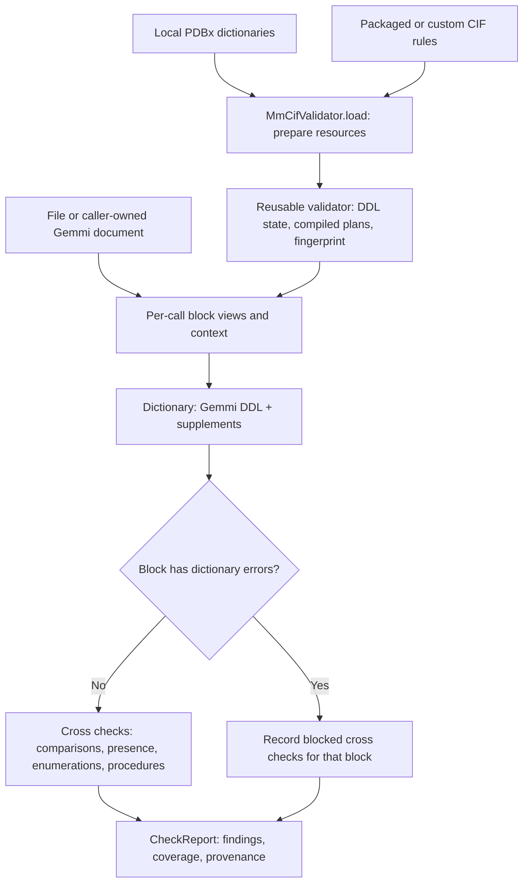

# Local mmCIF validation

`onedep_lib.validation` validates files offline with a reusable `MmCifValidator`.
Dictionary checks enforce PDBx/DDL2 definitions; cross checks enforce relationships
and deposition rules across values and categories. No deposition session or
authentication is required.

## Validate a file

Supply a local, complete PDBx dictionary, including `_item_type_list` definitions.
Dictionaries are not bundled or downloaded. Cross-check rules are packaged with
the library. The example reports rules missing dictionary definitions as blocked,
so dictionary-version differences remain visible in coverage.

```python
from pathlib import Path

from onedep_lib.validation import MmCifValidator, ValidationOptions

engine = MmCifValidator.load(
    [Path("mmcif_pdbx_v50.dic")],
    options=ValidationOptions(rule_dictionary_policy="block_rule"),
)
report = engine.validate_path(Path("model.cif"))

for issue in report.issues:
    print(issue.severity.value, issue.code, issue.rule_id,
          issue.location.item, issue.location.row, issue.message)

assert report.validation is not None
print("Complete:", report.validation.complete)
print("Valid:", report.validation.valid)
Path("validation-report.json").write_text(report.to_json(indent=2), encoding="utf-8")

# Reuse prepared resources for subsequent files.
other_report = engine.validate_path(Path("another-model.cif"))
```

`report.ok` means no ERROR/FATAL findings. `report.validation.valid` additionally
requires completion of the requested scope. Warnings alone do not invalidate a
complete result. Inspect `validation.phases` and `validation.rule_execution` for
blocked, skipped, or excluded checks; an empty issue list alone does not prove coverage.

## Architecture



This is the default two-phase flow. Other blocks continue when one block fails
dictionary checks. The supported dictionary failure policy is `stop_block`.

| Component | Responsibility |
| --- | --- |
| `engine.py` | Public API, preparation, scope selection, phase ordering, report metadata. |
| `dictionary.py` | Owns Gemmi DDL state for types, enumerations, mandatory items, keys and links; adapts diagnostics and supplements mandatory values, numeric/date checks, advisory ranges, and simple/composite parent membership. |
| `rule_loader.py`, `models.py` | Compile CIF rules into typed plans, verify resource compatibility, expose immutable descriptors through `engine.rules`. |
| `evaluators.py`, `procedural.py` | Execute comparisons, linked/date checks, conditional requirements, enumerations, occupancy, sequence, accession, and wavelength checks. Algorithms live in Python; policy lives in CIF. |
| `cif_access.py`, `values.py`, `runtime.py` | Read category views, interpret values, build lazy block-local indexes, collect bounded findings and execution records. |
| `adapter.py` | Routes deposition file types to engines; converts unavailable resources and engine failures into advisory reports. |

## Resources and object lifecycle

`load(dictionary_paths, rules_path=..., options=...)` prepares resources once.
Omitting `rules_path` selects the packaged 149-rule coordinate bundle. A custom
bundle **replaces** it; bundles are not merged. Multiple dictionaries must have
compatible definitions. Invalid resources or options raise
`ValidationConfigurationError` before file validation.

By default, missing dictionary definitions needed by a rule reject preparation.
`ValidationOptions(rule_dictionary_policy="block_rule")` instead blocks affected
rules and reports incomplete coverage. Dictionary metadata can also be supplied
in cross-only mode for rules that depend on dictionary enumerations.

| Object or resource | Lifetime and ownership |
| --- | --- |
| `MmCifValidator` | Reuse for a batch or application lifetime. Retains prepared DDL state, dictionary bytes/metadata, compiled rules, immutable options, and digests. No `close()` or context manager is required. |
| Dictionary and rule files | Read during preparation. Disk changes require a new `load()`. Category-scoped DDL state is created lazily from saved dictionary bytes and reused. |
| `validate_path()` input | Parsed afresh and hashed on every call. The document is local to the call; keep the file stable during validation. |
| `validate_document()` input | Caller-owned, read without mutation or reparsing. Keep it unchanged during validation. No input-file digest is recorded. |
| Block views, indexes, collector, resolved context | Created per call. Checks share indexes within a block, then discard them; the engine does not cache input documents or results. |
| `CheckReport` | Caller-owned and independent of later runs. Findings and frozen metadata retain coverage, resource fingerprints and digests. Serialize with `to_dict()` or `to_json()`. |

One engine serializes validation through a lock because Gemmi DDL state and
callbacks are mutable. Use a separate engine per worker for parallel execution.
Memory includes the parsed document, prepared resources, temporary indexes, and
retained reports; validation is not streaming. The default cap is 10,000 findings,
plus a terminal FATAL on overflow. Cancellation and limits mark results incomplete;
native Gemmi calls finish before Python can observe cancellation.

Canonical PDBx/DDL2 tags are supported. Dictionary alias declarations are accepted,
but alias tags in input require normalization and yield incomplete validation.
Populated items with unresolved alternative parents also yield incomplete validation.
Gemmi diagnostics are not exhaustive and location precision varies; consult
`validation.dictionary_coverage`.

## Select phases and scope

These examples continue the imports and `engine` from above:

```python
import gemmi

from onedep_lib.validation import ValidationContext

# Dictionary checks only: cross-check rules are not compiled or executed.
dictionary_engine = MmCifValidator.load(
    [Path("mmcif_pdbx_v50.dic")],
    options=ValidationOptions(phases=("dictionary",)),
)
dictionary_report = dictionary_engine.validate_path(Path("model.cif"))

# Cross checks only: useful for fixtures; dictionary coverage is excluded.
cross_engine = MmCifValidator.load([], options=ValidationOptions(phases=("cross",)))
cross_report = cross_engine.validate_path(Path("model.cif"))

# Reuse a parsed document and select checks owned by atom_site.
document = gemmi.cif.read_file("model.cif")
scoped_report = engine.validate_document(
    document,
    source="model.cif",
    categories=["atom_site"],
    context=ValidationContext(experiment_modes=("xray",), requested_codes=("PDB",)),
)
```

Omitting `categories`, passing `None`, or passing `[]` selects all categories.
Names are case-insensitive; `_atom_site.` and `atom_site` are equivalent.
Selection uses `RuleDescriptor.check_category`; other categories remain available
as lookup targets. Completion describes only the requested scope.
`ValidationOptions(blocks=("block_name",))` similarly selects data blocks.

Experiment modes default to inference from `_exptl.method`. Entry subtypes and
requested archive codes require explicit `ValidationContext`; archive requests
are not guessed from entry IDs. Use `block_overrides` for differing block contexts.

## Time cross checks

Use `--profile` to print every executed OneDep rule, slowest first, and save
the ranking alongside the report:

```bash
uv run python scripts/validate_mmcif.py mmcif_pdbx_v50.dic model.cif \
  --engines onedep --profile -o timings.json
```

The JSON ranking is at `engines.onedep.cross_check_timings`. Each entry includes
`rule_id`, `family`, `total_seconds`, `executions`, `rows_examined`, and
`findings_emitted`. Times are summed across data blocks. Per-block timings remain
in `engines.onedep.report.validation.rule_execution[*].duration`, in seconds.
Rules blocked before evaluation or excluded by category have no duration and are
omitted from the ranking. Evaluators that run still have a timing, including
those that find a rule inapplicable or discover a blocking condition.

To profile cross checks even when dictionary input errors would block them, add
`--cross-only`; this omits dictionary input validation. Missing rule definitions
can still block individual rules. Profiling covers the OneDep engine; legacy
engine timing remains at the whole-run level.

For Python callers, enable the existing profiling option at preparation:

```python
profiled = MmCifValidator.load(
    [Path("mmcif_pdbx_v50.dic")],
    options=ValidationOptions(profile=True, rule_dictionary_policy="block_rule"),
)
report = profiled.validate_path(Path("model.cif"))
assert report.validation is not None
for timing in sorted(
    (row for row in report.validation.rule_execution if "duration" in row),
    key=lambda row: row["duration"],
    reverse=True,
):
    print(timing["rule_id"], timing["block_index"], timing["duration"])
```

Rule times measure elapsed evaluator time, including any indexes first built by
that rule. They exclude resource preparation, input parsing, dictionary checks,
and report serialization. Shared indexes benefit later rules, so compare repeated
runs on the same input and resource profile.

## Deposition integration

Configure `DepositConfig.mmcif_dictionary_paths` and optional `mmcif_rule_paths`
per file type, or inject an engine with `deposit_init(..., mmcif_validator=engine)`
or `deposit_resume(...)`. A single injected engine overrides coordinates; a
mapping of `FileType` to engine overrides several routes. New and resumed sessions
prepare each distinct configured resource profile once.

`dep.check_mmcif_file(file_id)` returns a report and updates `dep.metadata_report`.
`dep.deposit()` reruns checks on current files before upload and replaces that
collection. Findings are advisory and do not prevent submission. Unmapped
metadata/structure-factor routes use dictionary checks and report missing cross-check
coverage; missing dictionaries produce unavailable-validation reports.

See [Usage](usage.md#local-mmcif-validation) for configuration and deposition
examples, [API reference](api.md#mmcif-validation) for signatures, and the
[resource specification](crosschecks/validation-engine-specification.md) for custom
rule schemas and execution semantics.
